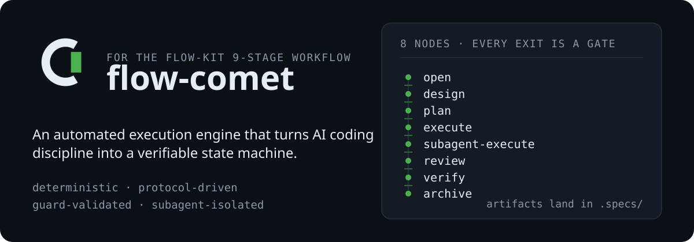
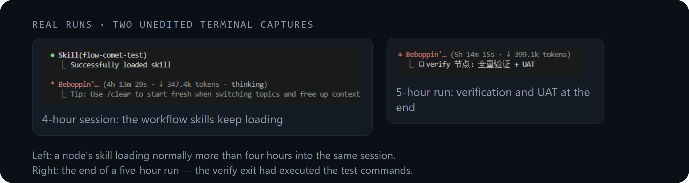
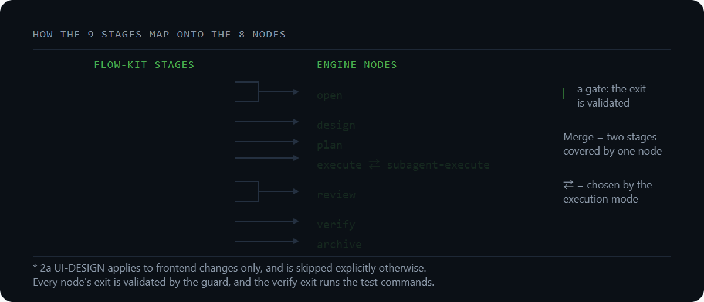
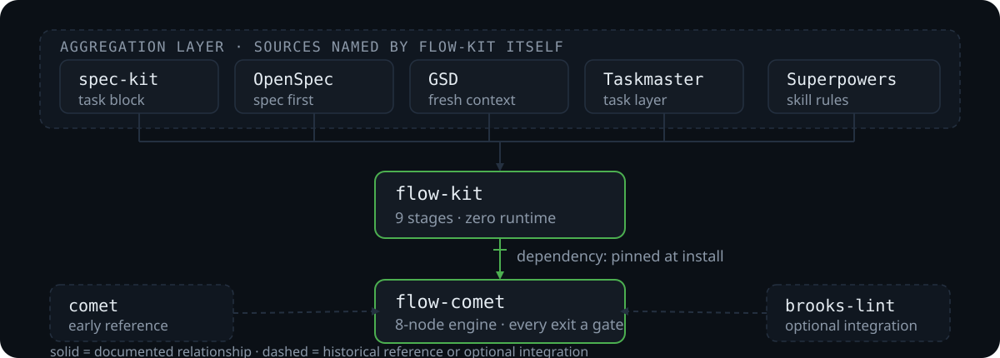

<div align="right">

[English](README.md) · [中文](README-zh.md)

</div>

<p align="center">
  
</p>

<p align="center">
  <a href="LICENSE"></a>
  <a href="https://nodejs.org"></a>
  <a href="https://github.com/baobaolaodie/flow-comet/actions"></a>
  <a href="CHANGELOG.md"></a>
</p>

<p align="center">
  <a href="https://claude.ai/code"></a>
  <a href="https://github.com/openai/codex"></a>
  <a href="https://github.com/deepseek-ai/deepseek-harness"></a>
  <a href="https://github.com/rihebty/flow-kit"></a>
</p>

---

## Quick Start

Three steps, run from your project directory:

```bash
# 1. Install the CLI globally (Node.js 18+)
npm install -g flow-comet

# 2. Go to your project
cd <your project>

# 3. Install flow-comet into it
fcomet init
```

`fcomet` and `flow-comet` are two names for the same installer. The `init` token may be omitted whenever another argument expresses the intent (`fcomet --target <dir>`), and `--target` itself defaults to the current directory; called with no arguments at all the command prints its usage and exits non-zero instead of installing. On a terminal, a run without `--platform` asks which platform to set up — the arrow-key selector pre-selects the platforms it detects, and the fallback prompt takes the detected platform as its default (Claude Code when several traces are present); for a non-interactive pick use `--platform claude-code`, `--platform codex`, `--platform dsh`, a comma-separated combination such as `--platform claude-code,dsh`, or `--platform all`. Re-running the same command updates an existing install and is idempotent. Upgrading the global package only replaces the CLI — run `fcomet init` in a project again to refresh that project's copy.

**Verify**:

```bash
fcomet --version                                   # the installed CLI version
cat .claude/skills/flow-comet/INSTALLED_VERSION    # the version written into this project
```

The installer writes the marker to `.claude/skills/flow-comet/INSTALLED_VERSION` for Claude Code, `.agents/skills/...` for Codex and `.dsh/skills/...` for dsh. It records the version the copy came from: the package's release version for an npm install, or the repository's `git describe` value for an install run from a clone (that form carries a `-<n>-g<hash>` suffix when the clone is ahead of its tag).

## Use it

Open a session in your project and invoke the workflow:

- **Claude Code** — `/flow-comet`
- **Codex** — invoke the skill (`/use flow-comet`, or simply ask for the flow-comet workflow in natural language)
- **DeepSeek Harness** — invoke the `flow-comet` skill

The first call confirms scope, then creates the branch for the change, initializes the state and enters the first node, producing that change's `CHANGE.md` / `REQUIREMENT.md` under `.specs/`. Every later stage is routed automatically — you only answer the decision points (scope, tech stack, destructive changes, review findings, archive confirmation). On first use in a project it detects a missing project context and offers to build one from your existing documents before starting.

To see where it is, just ask it — or inspect it from the command line with `status` and `next` in the project (the per-platform paths are in [Installation](docs/INSTALLATION.md)).

Artifacts live in `.specs/<change-id>/`; on archive they move to `.specs/archive/<date>-<change-id>/` and a row is appended at the top of `.specs/CHANGELOG.md`. The node-by-node walkthrough — including what the workflow runs underneath, and how to drive a node by hand when you need to — is in [Usage](docs/USAGE.md).

## Pick a platform

| Platform | Skills install to | Hook / bridge | First use |
|---|---|---|---|
| Claude Code (default) | `.claude/skills/` | `settings.local.json` → `hooks.PreToolUse` | the workspace must be trusted; headless sessions need that trust pre-accepted |
| Codex | `.agents/skills/` | `.codex/hooks.json`, plus a managed block in `AGENTS.md` | trust the project hook once (interactive), or pass the automation flag for scripted runs |
| DeepSeek Harness (dsh) | `.dsh/skills/` | global bridge loader under `$DSH_HOME`, plus a managed block in `AGENTS.md` | no hook-trust step |

Prerequisites, all four install options, the per-platform verification steps and uninstall/reset behaviour: [Installation](docs/INSTALLATION.md).

## Real-run artifacts

A complete 8-node run leaves the artifact trail below — [a real archived change](docs/examples/processor-pipeline/) from the end-to-end test project (2026-08-13), kept in this repository as the quality reference: CHANGE / REQUIREMENT / DESIGN / TASK / six-section summaries / REVIEW with disposition markers / TEST / UAT / KNOWN-ISSUES / skill-load declaration markers.

```
processor-pipeline/            (archived change, full artifact set)
├── CHANGE.md / REQUIREMENT.md / DESIGN.md / TASK.md
├── T01~T06-SUMMARY.md          (six-section summaries)
├── REVIEW.md                   (findings with disposition markers)
├── TEST.md / UAT.md            (verify actually executes the test command)
├── KNOWN-ISSUES.md
└── .skill-loads/               (11 skill-load declaration markers)
```

Two captures from real sessions of this project, unedited: a workflow skill loading normally more than four hours in, and the end of a five-hour run whose verify exit had already executed the test commands.

<p align="center">
  
</p>

## How it works

The process is flow-kit's nine stages; the engine runs them as eight nodes. CHANGE and REQUIREMENT are covered by `open`, TEST and REVIEW by `review`, and DEV runs as `execute` or `subagent-execute` depending on the execution mode. Every node's exit is validated before the next one opens — the `verify` exit really executes the commands in `TEST.md` — and each node's artifacts land under `.specs/<change-id>/`.

<p align="center">
  
</p>

Driving a node by hand, the artifacts each node produces, and the two command surfaces are documented in [Usage](docs/USAGE.md); what the engine guarantees and how a node's exit is validated are in [Core Mechanisms](docs/MECHANISM.md).

## Why flow-comet

1. **Discipline goes from "self-discipline" to "machine-checked"** — every stage entry/exit has script validation: artifacts complete, sections filled, verify commands actually run, tasks stay in bounds.
2. **No lost progress across sessions** — where you are is always derived from `.specs/` artifacts, never from conversation memory; reopen and continue from the right node.
3. **Implementation and coordination are separated, and the separation is enforced** — implementation runs in fresh-context subagents that must return a verified contract; the guard decides by the caller's identity before it resolves any path, so an isolated worktree is one way to provide write permission rather than a requirement. The coordinator is banned from writing source, and writes outside the current node's scope are refused by the hook. The layers themselves are described in [Core Mechanisms](docs/MECHANISM.md).

### Related projects

<p align="center">
  
</p>

| Project | What it is, and how it works | Relationship to flow-comet |
|---|---|---|
| **flow-kit** | Pure-Markdown methodology pack: 9-stage process, `.specs/` templates, R1–R8 rules, no runtime. You load the stage prompts by hand; state travels through `.md` artifacts. An install pins a specific commit. | **Dependency — the base, and the aggregation point.** flow-comet is its automation layer: templates, rules and artifact shapes are inherited from upstream, and this repository only adds the increment sections upstream does not define; the template is the sole authority on shape, and documents without an upstream template (`UAT`, the archive's leftovers list) are checked for existence only. The projects below reached flow-comet through it. |
| **OpenSpec** (Fission-AI) | Spec-driven development framework: a lightweight spec layer before coding. One `proposal` / `specs` / `design` / `tasks` set per change under `openspec/`; the default profile runs propose → apply → sync → archive. | **Aggregated through flow-kit** (idea source). Standalone it stays lighter: no state machine, no gates. |
| **Superpowers** (obra) | Agentic skills framework plus a full development methodology, installed per harness across Claude Code, Codex, Cursor, Gemini CLI and more. Skills trigger by context and are enforced by instructions. | **Aggregated through flow-kit** (idea source, partial overlap). Discipline lives in skill text and relies on model compliance; flow-comet machine-checks the same discipline. |
| **comet** (rpamis) | Resumable long-running task workflow and skill platform: a five-stage state machine, stage guards, hook write-interception. `/comet` routes from config and defaults to its Native branch. | **Early mechanism reference, now decoupled.** The hook-injection shape and script-owned state came from here; the naming was decoupled and state does not interoperate. Only its Classic branch carries the OpenSpec + Superpowers lineage. |
| **GSD** | Spec-driven development meta-prompt and context-engineering workflow: milestones → phases → plans, a fresh context window per agent with scoped payloads, worktree isolation and a UAT gate. | **Aggregated through flow-kit** (idea source, same lane). Fresh-context execution and stage gates align; routing stays prompt-driven. |
| **spec-kit** (GitHub) | SDD toolkit: Specify → Plan → Tasks → Implement → Converge. Each stage feeds markdown artifacts to the next, with order ids, `[P]` parallel markers and file paths in the task block. | **Aggregated through flow-kit** (idea source, same lane). That task-block shape is what flow-kit's TASK template inherited; stage transitions are not enforced. |
| **claude-task-master** | AI-driven task management over MCP and a CLI: PRD parsing → task breakdown → dependency graph → next-task orchestration. Distributed under MIT with Commons Clause. | **Aggregated through flow-kit** (complement). Covers the task layer only: no stage gates, no artifact validation, no write permissions. |
| **brooks-lint** (hyhmrright) | Third-party review engine grounded in twelve classic engineering books: 6 production and 6 test decay risks, findings cited as Symptom → Source → Consequence → Remedy, a 0–100 health score and six modes. | **Optional integration (MIT, not a dependency).** Where installed, five of its six commands back the self-check and review rounds; absent, the workflow degrades along a declared fallback chain. |

**Fit**: flow-comet is built for long-running, multi-session development changes. The contract is the same on all three platforms — write permission, commit isolation, verification isolation and integration discipline — while the depth of testing differs per platform, and the per-platform coverage is stated in [Core Mechanisms](docs/MECHANISM.md#parallel-delegation). It is not a general CI/CD or project-management tool; other platforms (Gemini / Cursor) are not guaranteed.

## Recommended: brooks-lint

The quality checks are grounded in the decay-risk framework of [brooks-lint](https://github.com/hyhmrright/brooks-lint), a third-party (MIT) review engine that diagnoses code against twelve classic engineering books. Where it is installed, the per-task self-check, the review node's code-quality round and the test-quality check run through it, and the `health` side command folds its result into its report; where it is not, the workflow still completes along a declared fallback chain and says so. It is not a dependency and nothing needs configuring on the flow-comet side; its installer covers more platforms than this project does, with a different depth of verification per platform — the details are in [Installation](docs/INSTALLATION.md).

## Relationship to the upstream project

flow-comet automates the methodology of [flow-kit](https://github.com/rihebty/flow-kit) — its stages, artifacts, rules and templates are inherited rather than reinvented. The two projects do not share files: flow-kit is consumed as a read-only, pinned dependency, and this repository vendors a copy only as a format baseline. What may be borrowed, and how divergences are declared, is written down in [CONTRIBUTING.md](CONTRIBUTING.md#borrowing-boundary).

## Documentation

| Document | What it is the single place for |
|---|---|
| [Installation](docs/INSTALLATION.md) | Prerequisites, the four install options, platform choice, verification, and reset (purge is delete-and-rebuild, not uninstall) |
| [Usage](docs/USAGE.md) | The 8-node workflow, the per-node lifecycle and its commands, artifacts, branch mode, execution modes, user entry points |
| [Core Mechanisms](docs/MECHANISM.md) | The behaviour contract, the three defense layers, guard validation, and custom protocols |
| [Troubleshooting](docs/TROUBLESHOOTING.md) | Symptoms grouped by where they bite: installation, first run, a stuck node, platform |
| [Versions](docs/VERSIONS.md) | Version semantics, the places that record the version, and the release checklist |
| [CHANGELOG](CHANGELOG.md) | Per-version history |
| [Contributing](CONTRIBUTING.md) | Contribution flow and the borrowing boundary |
| [Security](SECURITY.md) | Reporting a vulnerability |

## Contributing

Full guide in [CONTRIBUTING.md](CONTRIBUTING.md) — branch model (`feature → dev → main`), PR workflow, merge rules, and commit convention. In short:

1. Branch from `dev`: `git checkout dev && git checkout -b feat/<description>`
2. Edit skills/scripts under `.flow-comet/skills/` (authoritative source); TDD with RED scenario first
3. Run regression: `node .flow-comet/skills/flow-comet/scripts/guard-self-test.mjs` → `ALL 350 SCENARIOS PASSED`
4. Open a PR into `dev` (squash — one change-level commit); release PR `dev → main` (merge — dev's change-level commits enter main, and dev stops leading after each release)

CI enforces the repository conventions automatically on every PR and push: regression, installer reproducibility, workflow and bilingual-mirror quality, PR discipline, version consistency, and dead links. Local hooks (commit/push message checks) install with `node scripts/install-commit-hook.mjs` — see [CONTRIBUTING.md](CONTRIBUTING.md) for the full guide.

## License

[MIT](LICENSE) © 2026 baobaolaodie

flow-comet depends on [flow-kit](https://github.com/rihebty/flow-kit) (MIT). Its mechanism shapes were borrowed from [Comet](https://github.com/rpamis/comet) (MIT), which it does not depend on.
