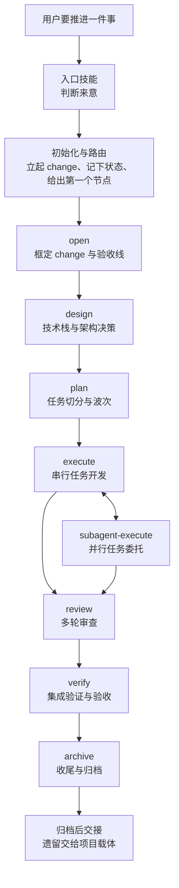
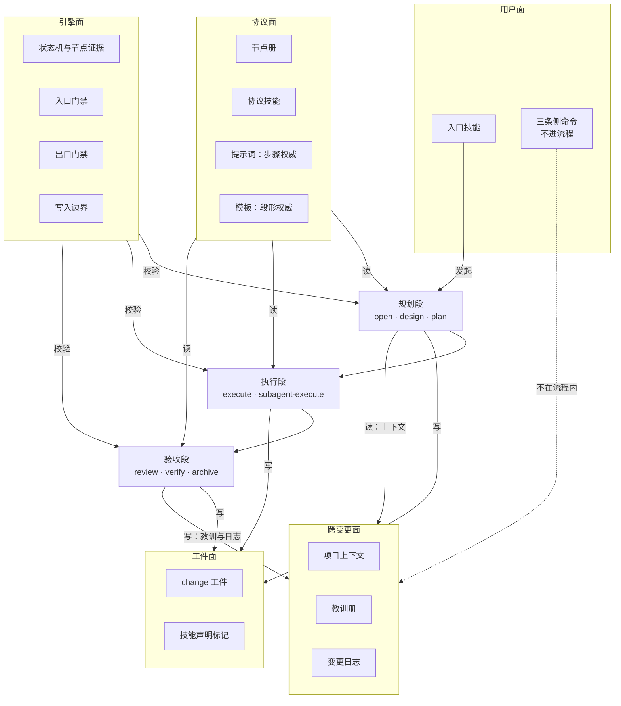
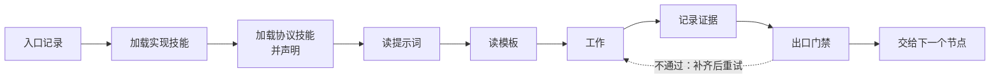

# 工作流参考：八个节点

[English](NODES.md) · [中文](NODES-zh.md)

## 这页是什么

这一页按节点讲一遍 flow-comet 的八个节点：每个节点由谁加载、读哪份提示词与模板、动手做什么、被什么拦住、做完之后去哪里。它写给已经决定跑这条工作流、想知道「流程在每一步里到底替我做主了什么」的读者，不是一步一步敲命令的操作手册。

三份公开文档的分工不同，读之前值得先分清。使用页讲怎么驱动一个节点、工件放在哪、命令怎么敲，是工作流这一面的契约权威；机制页讲引擎保证什么、门禁按什么判、执行怎么隔离，是行为面的权威；这一页只做节点级的综合，把节点册、协议、提示词与模板摊在同一套栏目里对照。三份都不是执行者的作业权威——执行者在节点里真正读的是节点册与提示词，本页只是让读者不必先通读它们就能建立正确的心智模型。

读法可以先公共后分节。公共部分讲所有节点共有的那条生命周期，以及两层加载、两条权威、声明与证据、写入边界、决策四分类几个横切面；从逐节点开始，每个节点都用同一套栏目写：职责、加载哪些技能、读哪份提示词与模板、动手做什么、产出什么工件与证据、出口检查什么、停在哪里或往哪里去。

这一页不给可以直接照抄的任务示例。每个项目的 change 不同——工件内容、任务切分、验证命令都随项目走——把某一次的内容写进参考页，容易把特化细节当成通用规律。页面给的是节点本身的行为：产出长什么样以模板为准，方法以提示词和节点册为准。

八个节点是默认协议。任何已安装技能都能组合成自定义协议，由同一套引擎驱动——路由、门禁、写入边界的判据不变，变的只是有哪些节点、每个节点声明什么技能与模板；本页只描述默认的这八个。

## 工作流的形状

工作流的形状是一条主链加执行段的往返。一次想要推进的事情从入口技能开始：初始化把一个 change 立起来，并把路由交给第一个节点；open、design、plan 依次把「为什么做、做什么、怎么做、拆成哪些任务」定下来；执行段由 execute 与 subagent-execute 两个节点承担，前者消化串行任务，后者把依赖已满足的并行任务成批委托出去，两者按任务状态交替，直到任务全部完成；review、verify、archive 依次收口——审查每一条发现、真实执行验证命令并逐条走验收、把 change 归档并把经验沉淀到 change 之外。

**图 1 · 从入口到归档的主链路**

图里的每个节点只标一句职责短语，不是步骤。执行段的两个节点会被多次进入，所以那一段不是直线；同一节点重新进入时仍然要走完整条生命周期，不会因为「刚才已经来过」而省掉入口与出口。

节点顺序是门，不是建议。前一个节点的工件没有通过出口，后一个节点就进不去；路由也不是把名字往后挪一个——它每次都从产物与任务状态重新推导当前该在哪个节点：上游工件齐了才进下一道门，任务状态决定执行段走哪一个，全部完成且摘要齐了才轮到审查。所以「先做一点后面的再回来补」在这条工作流里不成立，能省的只有节点内的写法，不能省的是门口。

工作流之外还有交接：归档出口通过之后，遗留清单交给项目已经在用的载体——这是执行者按技能文本做的一步，没有门禁校验它，也不改变 change 已经归档的事实。

## 完整架构

把镜头拉远，工作流是五个面叠起来的：用户面、协议面、引擎面、工件面、跨变更面。用户面决定什么时候开始、要不要走侧命令；协议面是执行者读到的全部作业方法与产出约束；引擎面是状态、门禁与写入边界；工件面是唯一真相；跨变更面在单个 change 之外累积，只在这个 change 的起点与收尾被读写。

**图 2 · 五个面与节点主链路**

层间的箭头只有三种含义，读懂它们就够读完这张图：协议面到主链路是「读」——执行者按节点加载技能、按提示词走步骤、按模板产出；主链路到工件面是「写」——工件与声明标记落在 change 的目录里；引擎面到主链路的「校验」贯穿进入与出口两头，进入时查前一个节点的出口与本次进入的条件，出口时查工件、声明、证据与各节点特有的判据。跨变更面不在每次往返里出现，它只在边界处被读或写。

### 五层怎么读

五层不是五个目录，而是同一件事的五个面。顺着「谁发起、谁给方法、谁把关、落在哪、跨 change 怎么累积」读一遍，再回到节点看每一步穿过哪几层。

| 面 | 装什么 | 谁读它 |
|---|---|---|
| 用户面 | 入口技能与三条侧命令 | 用户 |
| 协议面 | 节点册、协议技能、提示词、模板 | 执行节点的 agent |
| 引擎面 | 状态机与节点证据、入口与出口门禁、写入边界 | 引擎自己；agent 只能经引擎给出的命令间接写入 |
| 工件面 | change 工件与技能声明标记 | 门禁、路由与下一次会话 |
| 跨变更面 | 项目上下文、教训册、变更日志 | 每个 change 的起点与收尾 |

按这条读法，一次节点往返只穿过前四层：用户面给了起点，协议面给了方法与段形，引擎面把门，工件面留下产出与声明；跨变更面在往返里不出现，只在 change 开始（读上下文）与归档（提名教训、登记变更）时被动到。三份文档的分工也由此而来——使用页写第一层与第四层的操作面，机制页写第三层的判据，这一页写第二、三层在每个节点上的落法。

## 每个节点共有的事

八个节点做的事不同，但每一步都走同一条生命周期：入口记录、加载实现技能、加载协议技能并声明、读提示词、读模板、工作、记录证据、出口门禁、交给下一个节点。这条顺序里有两处不能换位——声明必须早于任何动作（先加载、再声明、后干活），证据必须早于不可逆的动作（搬目录之前就要把证据记好）。

**图 3 · 一个节点的公共生命周期**

入口不是打卡：进入检查本身有内容——协调者禁令、委托前的检查、任务集签名都在这一步记录或核对；跳过入口直接想出口，会被判成进入未记录而拦下。出口也不是写总结：它逐项核对这个节点的工件、声明覆盖与证据，以及各节点特有的判据——任务是否全部完成、审查发现是否都有处置、验证命令是否真的跑过并成功——全过才推进。

这条生命周期是每个节点各走一遍，不是整个 change 走一遍。执行段的两个节点可以多次往返，每趟都重新走完整条链：重新进入、重新校验，不会因为上一趟已经来过而跳过。

### 两层加载

节点加载分两层，缺一层都算没加载完。第一层是这个节点的实现技能：它规定这个节点要做的事、按什么标准算做完，路由到达时由入口给出，必须用技能加载的方式让它生效——只读文件不算加载。第二层是协议技能：各阶段的方法协议（框定、需求、设计、界面、任务、开发、测试、集成），由实现技能按节点声明该加载哪几份。

协议技能只在加载后才真正生效，加载动作要留下声明：声明同时写清这个节点该读的每一份提示词与模板清单。声明与加载是两件事——声明记录「要求你读了什么」，不证明读过；但出口要求声明覆盖整个节点而不是抽样，该读的每一份协议、每一个必需的协议技能都要有声明，缺一项就逐项点名并给出补齐办法，节点不放行。

节点之间有差异：open 与 review 各要两份协议；design 的界面协议只对前端 change 成立，判据来自框定工件的视觉调性段，非前端不加载也不声明；verify 与 archive 没有模板，声明里不出现模板清单。委托出去的那部分，协议由子代理自己声明，协调者不代记。

### 两条权威

每个节点入口会给出两条指针，顺序固定：先提示词，后模板。提示词管步骤——这一步分几段走、每段要回答什么、什么时候停；模板管段形——产出物的标题、首部字段、段序与每个段的存在形态。两者分工不重叠，所以两条都要读，读完才算完成加载。

顺序本身就是语义：先知道怎么做，再看做出来该长什么样。没有上游模板的节点（verify 与 archive）只给提示词那一条；有模板的节点两条都给，前端 change 还会多给一条条件指针——界面提示词与界面模板，判据与视觉调性段同源。

这两套权威都是随包引入的上游基准，只读、不随本仓改动。上游提示词与模板在段号或段表上偶有分歧时，本仓不静默照其中一边执行，而是在入口册与节点册逐条声明哪些不采用、哪些沿用、冲突以哪一处为准；模板是产出的段形权威，提示词仍是步骤权威。模板缺席时出口报「未校验（模板缺失）」，而不是当作通过。

### 声明与证据

两类记录都会写进状态，但管的事不同。声明回答「这个节点要求读了什么」——每个必需技能一份，可以分散在多次加载里，出口按节点汇总核对覆盖。证据回答「这个节点做完了」——一份摘要，写明做了什么、验证命令的真实输出、自查结论，可以附带声明完成的检查项与教训提名；没有证据，出口直接拦。

两者都不能替代工件：声明不证明读过，证据不证明做对，真正判定产出是否合格的是工件自身的骨架、项目级文档的存在性，以及各节点特有的判据。状态里也不存对话内容，下一次会话只看工件与证据就能接着做。

委托节点的证据形态不同：它没有自己的工件，证据是一对请求与结果；子代理回传的契约要带提交、验证的真实输出，以及它声明完成的检查项，缺一项就退回。归档节点的证据还要对上提名记录——扫了几份摘要、提名了哪些条目、没有提名时为什么，三样都要能核验。

### 写入边界

每个节点都有写权限范围：超出范围的写入在落盘前就被拒绝——平台层先把目标解析成物理路径，再按当前节点的白名单比对，目录链接不能把允许的写入引到别处。这一层与门禁分工不同：门禁管节点能不能推进，写入边界管这次动作能不能落盘；两者都过不去，就没有「先写了再说」。

默认执行模式下，协调会话不得亲自执行实现任务：委托阶段它只能写工件与任务状态，源码改动必须交给子代理。子代理是执行者，按任务的写集放行；但状态文件与协议文件属于最小保护集，对谁都不放行——手改它们正是状态失真的来源。判定按身份而不是按路径：平台把调用方标成子代理，子代理语义就先于路径判定生效。

这条边界不等于沙箱：脚本正文、解释器与命令文本里的目标并不都被分析，宿主权限允许时仍可能绕过。所以准确的表述是把白名单当作「所用工具」的边界，而不是把写入整条封死；工具面的细节见[使用](USAGE-zh.md#dsh-上的工具面)。

### 决策四分类

执行者先给眼前这件事分类，再决定要不要停下来问。分类错了只有两种后果：把该问的事替用户定了，或者把该做的事推回给用户。

| 分类 | 判据 | 处置 |
|---|---|---|
| 用户决策 | 存在两个以上会改变范围、行为、风险或不可逆结果的合法选项 | 停下来问；相邻选择合并，不重问已经定过的事（框定阶段每轮最多三问）；非交互会话里报成未决并停下 |
| 自动处理 | 唯一安全下一步 | 直接做并汇报，不制造确认 |
| 停止条件 | 门禁失败、缺依赖或状态损坏 | 先诊断并执行唯一安全的修复；恢复方式有多个合法选项时才升级为用户决策 |
| 手动交接 | 动作本身标记为人工交接 | 不是决策，直接继续，不向用户提问 |

用户决策分布得并不均匀，集中在几处：框定时的主题与范围、设计时的技术栈、执行时的破坏性变更与数据迁移、切换直接执行模式、审查时的严重发现处置、验收第四次失败后的继续或停止、归档与分支收尾。这些问题的共同点是答案会改变范围或不可逆的结果、猜错要返工；其余的事都不值得问。

自动处理与停止条件的分界在「有没有唯一安全的一步」：有就直接做，没有才报阻塞与恢复条件。门禁失败也不是一律问人——先自己诊断，能执行唯一安全的修复就执行，只有恢复方式存在多个合法选项、或者要接受一个风险时，才升级成用户决策。

有一条默认贯穿四类：边界必须声明。凡是形似「用户授权」的动作——超过上限的修复轮次、重新进入已归档的 change、协调者接管任务——都要显式且留痕，沉默按拒绝处理。这条默认不区分节点，也不因为事急而放宽。按节点列出的确认点见技能树里的决策点参考册，下面逐节点一节只标出每个节点的决策点与下一跳。
