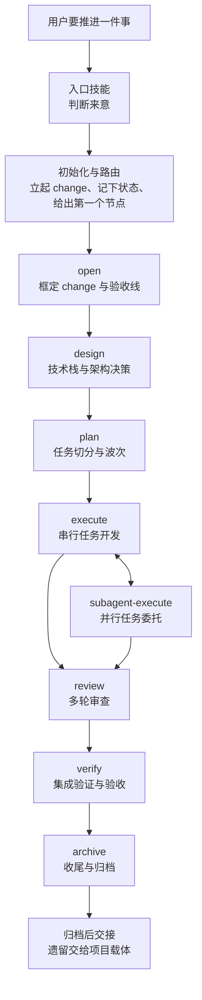
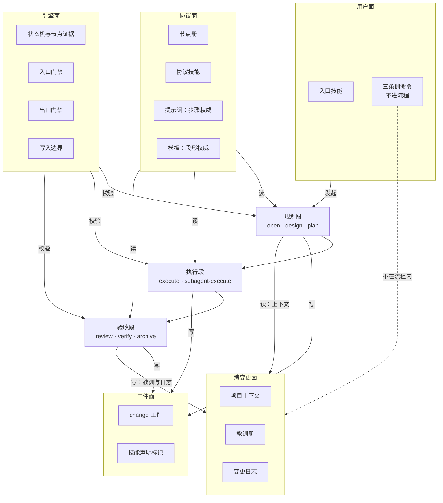
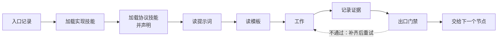
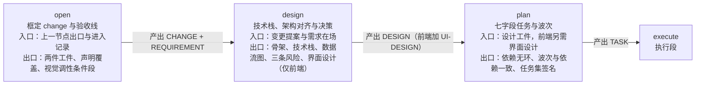
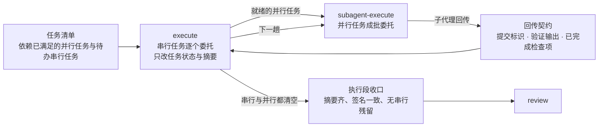
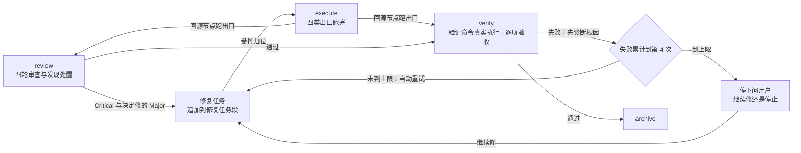
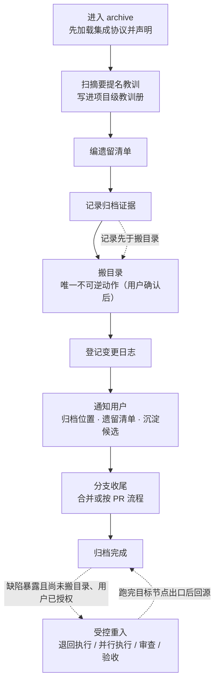

# 工作流参考：八个节点

[English](NODES.md) · [中文](NODES-zh.md)

## 这页是什么

这一页按节点讲一遍 flow-comet 的八个节点：每个节点由谁加载、读哪份提示词与模板、动手做什么、被什么拦住、做完之后去哪里。它写给已经决定跑这条工作流、想知道「流程在每一步里到底替我做主了什么」的读者，不是一步一步敲命令的操作手册。

三份公开文档的分工不同，读之前值得先分清。使用页讲怎么驱动一个节点、工件放在哪、命令怎么敲，是工作流这一面的契约权威；机制页讲引擎保证什么、门禁按什么判、执行怎么隔离，是行为面的权威；这一页只做节点级的综合，把节点册、协议、提示词与模板摊在同一套栏目里对照。三份都不是执行者的作业权威——执行者在节点里真正读的是节点册与提示词，本页只是让读者不必先通读它们就能建立正确的心智模型。

读法可以先公共后分节。公共部分讲所有节点共有的那条生命周期，以及两层加载、两条权威、声明与证据、写入边界、决策四分类几个横切面；从逐节点开始，每个节点都用同一套栏目写：职责、加载哪些技能、读哪份提示词与模板、动手做什么、产出什么工件与证据、出口检查什么、停在哪里或往哪里去。

这一页不给可以直接照抄的任务示例。每个项目的 change 不同——工件内容、任务切分、验证命令都随项目走——把某一次的内容写进参考页，容易把特化细节当成通用规律。页面给的是节点本身的行为：产出长什么样以模板为准，方法以提示词和节点册为准。

八个节点是默认协议。任何已安装技能都能组合成自定义协议，由同一套引擎驱动——路由、门禁、写入边界的判据不变，变的只是有哪些节点、每个节点声明什么技能与模板；本页只描述默认的这八个。

## 工作流的形状

工作流的形状是一条主链加执行段的往返。一次想要推进的事情从入口技能开始：初始化把一个 change 立起来，并把路由交给第一个节点；open、design、plan 依次把「为什么做、做什么、怎么做、拆成哪些任务」定下来；执行段由 execute 与 subagent-execute 两个节点承担，前者消化串行任务，后者把依赖已满足的并行任务成批委托出去，两者按任务状态交替，直到任务全部完成；review、verify、archive 依次收口——审查每一条发现、真实执行验证命令并逐条走验收、把 change 归档并把经验沉淀到 change 之外。

**图 1 · 从入口到归档的主链路**

图里的每个节点只标一句职责短语，不是步骤。执行段的两个节点会被多次进入，所以那一段不是直线；同一节点重新进入时仍然要走完整条生命周期，不会因为「刚才已经来过」而省掉入口与出口。

节点顺序是门，不是建议。前一个节点的工件没有通过出口，后一个节点就进不去；路由也不是把名字往后挪一个——它每次都从产物与任务状态重新推导当前该在哪个节点：上游工件齐了才进下一道门，任务状态决定执行段走哪一个，全部完成且摘要齐了才轮到审查。所以「先做一点后面的再回来补」在这条工作流里不成立，能省的只有节点内的写法，不能省的是门口。

工作流之外还有交接：归档出口通过之后，遗留清单交给项目已经在用的载体——这是执行者按技能文本做的一步，没有门禁校验它，也不改变 change 已经归档的事实。

## 完整架构

把镜头拉远，工作流是五个面叠起来的：用户面、协议面、引擎面、工件面、跨变更面。用户面决定什么时候开始、要不要走侧命令；协议面是执行者读到的全部作业方法与产出约束；引擎面是状态、门禁与写入边界；工件面是唯一真相；跨变更面在单个 change 之外累积，只在这个 change 的起点与收尾被读写。

**图 2 · 五个面与节点主链路**

层间的箭头只有三种含义，读懂它们就够读完这张图：协议面到主链路是「读」——执行者按节点加载技能、按提示词走步骤、按模板产出；主链路到工件面是「写」——工件与声明标记落在 change 的目录里；引擎面到主链路的「校验」贯穿进入与出口两头，进入时查前一个节点的出口与本次进入的条件，出口时查工件、声明、证据与各节点特有的判据。跨变更面不在每次往返里出现，它只在边界处被读或写。

### 五层怎么读

五层不是五个目录，而是同一件事的五个面。顺着「谁发起、谁给方法、谁把关、落在哪、跨 change 怎么累积」读一遍，再回到节点看每一步穿过哪几层。

| 面 | 装什么 | 谁读它 |
|---|---|---|
| 用户面 | 入口技能与三条侧命令 | 用户 |
| 协议面 | 节点册、协议技能、提示词、模板 | 执行节点的 agent |
| 引擎面 | 状态机与节点证据、入口与出口门禁、写入边界 | 引擎自己；agent 只能经引擎给出的命令间接写入 |
| 工件面 | change 工件与技能声明标记 | 门禁、路由与下一次会话 |
| 跨变更面 | 项目上下文、教训册、变更日志 | 每个 change 的起点与收尾 |

按这条读法，一次节点往返只穿过前四层：用户面给了起点，协议面给了方法与段形，引擎面把门，工件面留下产出与声明；跨变更面在往返里不出现，只在 change 开始（读上下文）与归档（提名教训、登记变更）时被动到。三份文档的分工也由此而来——使用页写第一层与第四层的操作面，机制页写第三层的判据，这一页写第二、三层在每个节点上的落法。

## 每个节点共有的事

八个节点做的事不同，但每一步都走同一条生命周期：入口记录、加载实现技能、加载协议技能并声明、读提示词、读模板、工作、记录证据、出口门禁、交给下一个节点。这条顺序里有两处不能换位——声明必须早于任何动作（先加载、再声明、后干活），证据必须早于不可逆的动作（搬目录之前就要把证据记好）。

**图 3 · 一个节点的公共生命周期**

入口不是打卡：进入检查本身有内容——协调者禁令、委托前的检查、任务集签名都在这一步记录或核对；跳过入口直接想出口，会被判成进入未记录而拦下。出口也不是写总结：它逐项核对这个节点的工件、声明覆盖与证据，以及各节点特有的判据——任务是否全部完成、审查发现是否都有处置、验证命令是否真的跑过并成功——全过才推进。

这条生命周期是每个节点各走一遍，不是整个 change 走一遍。执行段的两个节点可以多次往返，每趟都重新走完整条链：重新进入、重新校验，不会因为上一趟已经来过而跳过。

### 两层加载

节点加载分两层，缺一层都算没加载完。第一层是这个节点的实现技能：它规定这个节点要做的事、按什么标准算做完，路由到达时由入口给出，必须用技能加载的方式让它生效——只读文件不算加载。第二层是协议技能：各阶段的方法协议（框定、需求、设计、界面、任务、开发、测试、集成），由实现技能按节点声明该加载哪几份。

协议技能只在加载后才真正生效，加载动作要留下声明：声明同时写清这个节点该读的每一份提示词与模板清单。声明与加载是两件事——声明记录「要求你读了什么」，不证明读过；但出口要求声明覆盖整个节点而不是抽样，该读的每一份协议、每一个必需的协议技能都要有声明，缺一项就逐项点名并给出补齐办法，节点不放行。

节点之间有差异：open 与 review 各要两份协议；design 的界面协议只对前端 change 成立，判据来自框定工件的视觉调性段，非前端不加载也不声明；verify 与 archive 没有模板，声明里不出现模板清单。委托出去的那部分，协议由子代理自己声明，协调者不代记。

### 两条权威

每个节点入口会给出两条指针，顺序固定：先提示词，后模板。提示词管步骤——这一步分几段走、每段要回答什么、什么时候停；模板管段形——产出物的标题、首部字段、段序与每个段的存在形态。两者分工不重叠，所以两条都要读，读完才算完成加载。

顺序本身就是语义：先知道怎么做，再看做出来该长什么样。没有上游模板的节点（verify 与 archive）只给提示词那一条；有模板的节点两条都给，前端 change 还会多给一条条件指针——界面提示词与界面模板，判据与视觉调性段同源。

这两套权威都是随包引入的上游基准，只读、不随本仓改动。上游提示词与模板在段号或段表上偶有分歧时，本仓不静默照其中一边执行，而是在入口册与节点册逐条声明哪些不采用、哪些沿用、冲突以哪一处为准；模板是产出的段形权威，提示词仍是步骤权威。模板缺席时出口报「未校验（模板缺失）」，而不是当作通过。

### 声明与证据

两类记录都会写进状态，但管的事不同。声明回答「这个节点要求读了什么」——每个必需技能一份，可以分散在多次加载里，出口按节点汇总核对覆盖。证据回答「这个节点做完了」——一份摘要，写明做了什么、验证命令的真实输出、自查结论，可以附带声明完成的检查项与教训提名；没有证据，出口直接拦。

两者都不能替代工件：声明不证明读过，证据不证明做对，真正判定产出是否合格的是工件自身的骨架、项目级文档的存在性，以及各节点特有的判据。状态里也不存对话内容，下一次会话只看工件与证据就能接着做。

委托节点的证据形态不同：它没有自己的工件，证据是一对请求与结果；子代理回传的契约要带提交、验证的真实输出，以及它声明完成的检查项，缺一项就退回。归档节点的证据还要对上提名记录——扫了几份摘要、提名了哪些条目、没有提名时为什么，三样都要能核验。

### 写入边界

每个节点都有写权限范围：超出范围的写入在落盘前就被拒绝——平台层先把目标解析成物理路径，再按当前节点的白名单比对，目录链接不能把允许的写入引到别处。这一层与门禁分工不同：门禁管节点能不能推进，写入边界管这次动作能不能落盘；两者都过不去，就没有「先写了再说」。

默认执行模式下，协调会话不得亲自执行实现任务：委托阶段它只能写工件与任务状态，源码改动必须交给子代理。子代理是执行者，按任务的写集放行；但状态文件与协议文件属于最小保护集，对谁都不放行——手改它们正是状态失真的来源。判定按身份而不是按路径：平台把调用方标成子代理，子代理语义就先于路径判定生效。

这条边界不等于沙箱：脚本正文、解释器与命令文本里的目标并不都被分析，宿主权限允许时仍可能绕过。所以准确的表述是把白名单当作「所用工具」的边界，而不是把写入整条封死；工具面的细节见[使用](USAGE-zh.md#dsh-上的工具面)。

### 决策四分类

执行者先给眼前这件事分类，再决定要不要停下来问。分类错了只有两种后果：把该问的事替用户定了，或者把该做的事推回给用户。

| 分类 | 判据 | 处置 |
|---|---|---|
| 用户决策 | 存在两个以上会改变范围、行为、风险或不可逆结果的合法选项 | 停下来问；相邻选择合并，不重问已经定过的事（框定阶段每轮最多三问）；非交互会话里报成未决并停下 |
| 自动处理 | 唯一安全下一步 | 直接做并汇报，不制造确认 |
| 停止条件 | 门禁失败、缺依赖或状态损坏 | 先诊断并执行唯一安全的修复；恢复方式有多个合法选项时才升级为用户决策 |
| 手动交接 | 动作本身标记为人工交接 | 不是决策，直接继续，不向用户提问 |

用户决策分布得并不均匀，集中在几处：框定时的主题与范围、设计时的技术栈、执行时的破坏性变更与数据迁移、切换直接执行模式、审查时的严重发现处置、验收第四次失败后的继续或停止、归档与分支收尾。这些问题的共同点是答案会改变范围或不可逆的结果、猜错要返工；其余的事都不值得问。

自动处理与停止条件的分界在「有没有唯一安全的一步」：有就直接做，没有才报阻塞与恢复条件。门禁失败也不是一律问人——先自己诊断，能执行唯一安全的修复就执行，只有恢复方式存在多个合法选项、或者要接受一个风险时，才升级成用户决策。

有一条默认贯穿四类：边界必须声明。凡是形似「用户授权」的动作——超过上限的修复轮次、重新进入已归档的 change、协调者接管任务——都要显式且留痕，沉默按拒绝处理。这条默认不区分节点，也不因为事急而放宽。按节点列出的确认点见技能树里的决策点参考册，下面逐节点一节只标出每个节点的决策点与下一跳。

## 逐节点

逐节点这一节按主链依次写 open、design、plan 与后面五个节点，每个节点都套同一套七栏：职责、加载技能、提示词与模板、动作、产出与证据、出口检测、决策点与下一跳。这几栏的事实来自三处，分工也不同——实现技能与必调协议技能、提示词与模板、产出与证据、入口与出口这些项以协议与引擎的 explain 视图为准；节点里怎么做以节点册为准；页面只做综合，不复述操作步骤。读的时候可以跳着读：只想知道这个节点拦什么，读职责与出口检测；只想知道它为什么会停下来，读决策点与下一跳。

### open

#### 职责

open 是把一句模糊想法框成一个 change 的节点：先问清楚为什么做、给谁、解决什么、何时算完，再落成一份变更提案与一份可验证的需求说明。它也是两个判定的发生地——这次是不是架构级变更、是不是前端 change，后者决定后面要不要追加界面设计。这里只定范围与验收线，不写实现，也不拆任务。

#### 加载技能

- 实现技能：flow-comet-open。路由到达时由入口给出，必须以技能加载的方式让它生效，只读文件不算加载。
- 协议技能两份：flow-comet-change 管框定（命名、架构级判定、视觉调性预选），flow-comet-requirement 管需求（验收准则、范围切分、术语入册）。两份都要加载，并各留一条声明。
- 本节点没有「仅条件」的协议技能：这两份对每个 change 都成立，差别只在框定阶段自己的步骤要不要走。

#### 提示词与模板

- 提示词两份：0-change 与 1-requirement，按框定在前、需求在后的顺序读。
- 模板两份：CHANGE 与 REQUIREMENT，对应两件工件。
- 先提示词、后模板；两份模板都在场才算加载完，声明里两条记录都写全这两份模板，节点级取并集。

#### 动作

- 生成 change 名：从描述里取 2~4 个短词，检查目录不重名，撞了自动加序号，并在第一轮消息里告诉用户。
- 架构级变更检测：按模块结构、既有决策冲突、公共契约、容量边界、跨服务编排五条判；命中就停下来让用户在三条路里选（先补架构基线、带架构影响声明继续、重判）。多数 change 不命中，不打扰用户。
- 前端识别与视觉调性预选：描述里有界面线索就判为前端，先单独一轮让用户从调性卡片里选一个，卡片里必须给首选、备选与明确排除；选定值写进变更提案的视觉调性段。非前端跳过这一步。
- 结构化反问：为什么做、给谁、解决什么问题、何时算完，每轮最多三问，不许替用户假设；调性卡片与需求问题不同一轮出现。
- 影响面与范围排除：判清要不要动需求、碰不碰架构、影不影响已有验收；范围排除至少写一条「这次不做」，否则后面会无声扩范围。
- 写验收准则：每条按给定—当—则写，且必须能被一条命令或一次人工操作验证；写不成一句话的就停下来问。范围按 v1 / v2 / out 三段切，术语与已锁决策写进项目上下文。
- 扫教训册：按本次的关键词查一遍，命中的条目要么声明与此前的差异，要么确认仍然适用。

#### 产出与证据

- 两件工件：变更提案与需求说明（CHANGE.md、REQUIREMENT.md），落在 change 目录下；项目上下文按需追加术语与已锁决策。
- 证据：一份节点摘要，id 为 intake-summary，写明产出了哪两件、用户是否确认。
- 变更提案的视觉调性段是条件段：前端必须有值，非前端要留下结构形态并标注不适用，而不是删掉。

#### 出口检测

- 两件工件的骨架与首部：变更提案的六段与需求说明的五段都在场且非空，首部的 change 标识不为空。
- 条件段与结构子段：视觉调性段标题必须在场；范围切分下的 v1 / v2 / out 三个子段在父段适用时必须在场。
- 项目上下文存在时一并查；模板缺席时如实报「未校验（模板缺失）」，不当作通过。
- 声明覆盖：两份协议技能的声明都在，且声明里的提示词与模板清单完整。
- 内容质量不在这道门里判：范围排除够不够、上下文有没有更新，属执行纪律，由审查节点把关。

#### 决策点与下一跳

- 用户决策：主题与范围的澄清；前端 change 还要选视觉调性。命名、影响面判定与路径建议属自动处理，做完汇报即可。
- 下一跳：design。两件工件过出口、声明齐了，路由才往下走。

### design

#### 职责

把需求变成可执行的技术设计：锁技术栈，对齐既有架构（碰哪些模块、复用哪些抽象、哪些禁动），写有取舍的决策、数据流图、可回溯决策记录与风险；前端 change 追加一份界面设计。这个节点只出设计，不出实现代码——签名与伪代码可以，完整函数体不行。

#### 加载技能

- 实现技能：flow-comet-design。
- 协议技能：flow-comet-design（本节点的同名条目随路由加载，补一条声明）；flow-comet-ui-design 是仅前端条件的条目——前端 change 加载并声明，非前端不加载、不声明。
- 界面协议不是「选配」而是条件成立：判据来自变更提案的视觉调性段，判据全文在界面设计册里，本页不重复。

#### 提示词与模板

- 提示词：2-design；前端 change 另加 2a-ui-design。
- 模板：DESIGN；前端 change 另加 UI-DESIGN。
- 界面这一对是条件指针：非前端既不读也不声明，声明清单里不出现。顺序仍是先提示词、后模板。
- 上游提示词与模板在段号上偶有分歧，本仓以模板的段名与段序为准，并在节点册里显式声明哪处不采用。

#### 动作

- 架构级预检：框定阶段已判定过的不重判；直接进到设计阶段的按同一套判据再判一次，命中且没有架构基线时请用户选。
- 锁技术栈：按需求与非功能需求筛出几张候选卡，给首选、备选与明确排除，等用户选定；项目上下文里已有已锁决策时直接用，纯库或命令行项目可以跳过。
- 既有架构对齐：用查证而不是记忆来列本次会碰的既有模块、新模块、可复用抽象与禁动清单；每项关键能力先问既有的能不能用，引新模式必须给理由。
- 写决策清单：一条决策要带备选、选择理由与取舍代价；「按最佳实践」这类说法不算理由。
- 画数据流与边界：至少一张图，说清数据或事件从哪来、到哪去，哪些是外部依赖与未触及模块。
- 写可回溯决策记录：以后可能被推翻的决策单独成文，留下背景、决定与后果。
- 评风险与范围外：风险至少三条（实现、上线、长期债务），每条给缓解；范围外显式写出这次不解决但将来要面对的问题。
- 记架构沉淀：本 change 有没有留下可复用抽象、项目级决策、跨模块契约、依赖变动或禁动清单变化，有就填，没有就整段写明无建议，不凑数。
- 前端追加界面设计：定美学方向与设计令牌（颜色、字体、间距、圆角、动效、阴影），并过一遍反套路自检。
- 扫教训册：按触碰的模块与技术决策查一遍，命中即声明差异或确认仍适用。

#### 产出与证据

- 主工件：设计说明（DESIGN.md；轻量流程可写 DESIGN-lite.md），第一段技术栈必须填齐。
- 前端 change 另有一份界面设计（UI-DESIGN.md），设计令牌都在里面；可回溯决策记录按需成文，落在项目决策目录。
- 证据：一份节点摘要，id 为 design-summary；前端 change 的摘要还要显式带上界面设计技能的声明完成项。

#### 出口检测

- 骨架：技术栈选定、决策清单、数据流与架构图、风险、不在范围五段无条件；既有架构对齐、关键状态机、决策记录索引、架构沉淀建议四段标题必须在场，不适用就写不适用。
- 技术栈段要填齐（前端、后端、数据库、部署、关键依赖、理由、明确排除），否则后面任务的验证命令与目录结构无从对齐。
- 既有架构对齐的三个子段在父段适用时必须在场；至少一张数据流图；风险至少三条；范围外必须写。
- 界面设计存在即查：前端 change 缺它就是硬拦；非前端放行，但出口要显式打出跳过，不静默通过。
- 声明覆盖：非前端只有一条声明，前端两条都在，且模板清单与前端适用性一致。
- 写集是否越界、对齐够不够细，属执行纪律，由审查节点把关。

#### 决策点与下一跳

- 用户决策：技术栈选型（上下文已锁时直接用、不重问）；架构级变更且缺架构基线时的那三个选项。
- 下一跳：plan。设计通过出口后，路由给出任务拆分。

### plan

#### 职责

把设计拆成可执行的原子任务：每个任务有读边界、写边界、一句可执行的验证、一句完成判定，并显式声明依赖。波次不是排版，而是依赖层级投影出来的执行顺序；执行段就按它分趟，只把依赖已满足的并行任务成批委托出去。

#### 加载技能

- 实现技能：flow-comet-plan。
- 协议技能一份：flow-comet-task，管拆任务、波次与边界规则。随路由加载后还要留一条声明，写明本节点该读的提示词与模板。

#### 提示词与模板

- 提示词：3-task。
- 模板：TASK。
- 上游提示词对并行的口径比本仓宽（无冲突即标并行、同层即同波），这一处不采用：并行标记与波次以节点册的约束为准，上游文件保持只读、不作修改。

#### 动作

- 先过前置门禁：需求与设计两件上游工件都得在；前端 change 还要有界面设计。缺一件就退回上一个节点，不自己脑补技术栈、触碰模块、禁动清单或写边界。
- 读技术栈与边界：技术栈段决定验证命令、依赖管理与目录结构；既有架构对齐段决定能写哪些文件、哪些禁动。
- 垂直切片：按文件冲突切，不按层切——一个任务是一条贯穿各层的功能线，而不是「先全部模型再全部接口」；一个文件只归一个任务，非拆不可时写明顺序与理由。
- 标并行：只给本波确有并发同伴、写集互不重叠的任务标并行；孤立任务一律串行。并行还要满足写权限、提交隔离、验证隔离、集成纪律四项条件，工作树只是写权限的一种实现，不是前提。
- 声明依赖：每个任务显式写依赖，没有依赖也要留一个空声明；依赖不得成环，也不得引用不存在的任务。
- 补齐七字段：名称、读集、写集、动作、验证、完成判定、依赖，一个不少；任务标识是任务块的属性，不算字段。写边界不得越出设计的触碰与新增范围，更不得包含禁动清单——这条边界与提交前的改动范围核对是同一条线。
- 排波次：每个任务的波次等于它依赖中最晚波次的下一波，无依赖即第一波；同波任务彼此不得依赖。想让某个任务晚跑就写依赖，而不是把它挪到后面的波却不声明。
- 扫教训册：按计划的文件与动作查一遍，命中即声明差异或确认仍适用。

#### 产出与证据

- 唯一工件：任务清单（TASK.md），含波次划分、任务块、状态字段说明、阻塞日志，以及留给审查阶段回填的修复任务区。
- 证据：一份节点摘要，id 为 plan-summary，写清任务数、波数与并行任务数；摘要不替代任务块里的字段。

#### 出口检测

- 至少有一个任务块；每个任务的七个字段在场；每个任务都要有可执行的验证，不是「测试通过」这类描述。
- 任务图：依赖无环、没有指向不存在任务的依赖；并行任务的写集不重叠——这一条只告警，但重叠仍然要修。
- 波次与依赖层级一致：不一致的逐条点出任务、依赖、当前波与应到波，并给两条出路——挪到应到的波，或补上依赖把顺序声明出来。没有波次段时报「未校验（无波次段）」并跳过，段在场却一行都落不到真实任务时报内容不可判并拦下；每个非修复任务都必须被某条波次行覆盖。
- 出口还会把任务集算成一份签名记下来，执行段据此判断任务集有没有被改过。
- 骨架与首部：五个段都在场；首部字段一旦出现就不能为空。
- 写集是否越界、并行标记是否必要，属执行纪律，由审查节点把关。

#### 决策点与下一跳

- 无用户决策：拆法与顺序由依赖图推出，不需要用户拍板。
- 下一跳：execute；若这一波里已有依赖满足的并行任务，路由先去 subagent-execute 把它们成批委托，再回 execute 消化串行部分。
- 「这个任务感觉该晚点跑」不是决策：那是依赖声明该表达的事，写在波次上会被出口拦回来。

**图 4 · 规划段的三个节点与每步的门禁**

### execute

#### 职责

execute 是执行段的一半：把任务清单里依赖已经满足、没有标并行的任务逐个做完，直到没有待办的串行任务。它默认不是写代码的人，而是协调者——任务交给新上下文的子代理，各自按开发协议走完；只有用户显式切到直接模式，主代理才亲自动手。并行任务不归它管，那部分由 subagent-execute 成批委托；两个节点按任务状态交替，直到全部完成。

#### 加载技能

- 实现技能：flow-comet-execute。随路由到达，必须以技能加载的方式让它生效，只读文件不算加载。
- 协议技能一份：flow-comet-dev，管测试先行、六维自查、边界检查、原子提交与教训扫描。默认模式下由每个被委托的子代理在自己的会话里加载并回传证明，协调者只登记本节点这一份；直接模式下由主代理自己加载并执行。
- 本节点没有仅条件成立的协议技能：开发协议对每个任务都成立，区别只在谁来执行。

#### 提示词与模板

- 提示词：4-dev。它是每个任务真正照着走的作业协议，委托时要原样交给子代理，不能用「参照上一份摘要」代替。
- 模板：SUMMARY，每个完成的任务一份。
- 本仓在摘要模板之外另登记了两个段落——自检方法与教训扫描。它们不在上游模板里，读模板时要一并知道它们的位置，否则交回的摘要会在出口被判缺段。
- 先提示词、后模板；声明里要写全这一对。

#### 动作

- 按执行模式推进：默认把待办的串行任务逐个委托给新上下文的子代理；直接模式是逃生口，必须用户显式切换，切换后主代理仍按开发协议走完测试先行、六维自查、边界检查与原子提交。
- 先登记委托、再启动子代理：同一任务的这两步是串行的两个动作，不能并进同一个并发调用。委托内容要内联任务块全文、设计里的技术栈与既有架构对齐段、相关验收准则，以及读写边界。
- 协调者只动三处：任务状态、任务摘要、委托记录。源码改动一律留给子代理，不代写、也不在协调会话里顺手修；派发失败记成阻塞并走恢复，不得接管实现。
- 逐任务验收回传：摘要的骨架、首部与段序要和模板一致，自检方法与教训扫描两段在场，验证输出是真实跑出来的，六维自查与越界检查有实质内容；都满足才在任务清单里标完成。
- 跳过并行任务：标了并行的待办任务不属于这里，交给 subagent-execute；本节点遇到它们直接放过，不当场做。
- 记住任务集签名：进入时把任务集算成一份签名，期间只允许改任务的完成状态；增删任务、改动作或改边界会让签名对不上，出口拦下后走计划重校，不手改状态。
- 全并行时也走正路：没有串行可做，路由应直接去 subagent-execute；确实进了本节点又无串行任务，要显式声明空退出，不能静默退出，更不能借机把并行任务做了。

#### 产出与证据

- 每个完成的任务一份任务摘要，落在 change 目录；任务清单里对应任务的状态随之更新。摘要不替代任务块的字段，但它是「这个任务确实做过」的凭据。
- 证据：一份执行摘要，id 为 implementation-summary，写清本节点完成了哪些任务、有没有走直接模式。
- 摘要缺席或是空骨架，等于没有产出：出口不会用一次口头汇报替代它。

#### 出口检测

- 串行残留：还有待办的串行任务就拦；标了并行的任务被本节点做过，按越权委托拦下。
- 摘要齐备：每个已完成任务都要有摘要，骨架、首部与段序按模板一致，自检方法声明落在三种取值之一，教训扫描段在场；填得好不好不在这里判。
- 任务集签名一致：与进入时算出的签名比对，任务被增删或内容被改就拦，并指出走计划重校。
- 空退出：全并行任务时不得空退出；确实无串行可做的，要显式声明空退出，出口放行并留一条审计提示，默认仍是拦。
- 模板缺席时如实报未校验，不当作通过；入口工件（变更提案、需求说明、设计说明）在存在时才查。

#### 决策点与下一跳

- 用户决策：破坏性变更（删改规模或公共接口触线）、数据迁移是否现在执行、以及要不要切到直接模式。其余不问，执行顺序由任务清单决定。
- 下一跳：还有依赖已满足的并行任务就去 subagent-execute；串行与并行都清空、摘要也齐了，才轮到 review。

### subagent-execute

#### 职责

subagent-execute 是执行段的另一半：把依赖已经满足的并行任务成批委托出去，收齐回传，验收后标完成。它不产出实现，只组织执行——主会话是协调者，源码始终由子代理写。执行段靠它和 execute 交替往返：一趟消化一批并行任务，趟与趟之间由 execute 消化串行任务，直到两者都清空。

#### 加载技能

- 实现技能：flow-comet-subagent-execute。
- 协议技能一份：flow-comet-dev，在本节点是委托范围——协调者要加载并在声明里登记；真正执行任务的那个子代理，在自己的会话里再加载一次并回传证明。协调者不代子代理声明。
- 没有条件式协议技能：每个并行任务都要走完整开发协议。

#### 提示词与模板

- 提示词：4-dev；模板：SUMMARY，每个被委托完成的任务一份。
- 委托提示里要把这两条指针写明：子代理开工前先读提示词，再读产出物模板，按标题、首部与段序填写，并补上本仓登记的两个段落。
- 只写「按模板填写」不算委托前检查完成；提示词与模板的指针要逐任务给出。

#### 动作

- 只挑依赖已满足的并行任务：任务块里标了并行、状态还是待办，且写集互不重叠；写集重叠的不并行派，先由任务清单的依赖把顺序表达出来。
- 协调者禁令：主会话不写源码、不做实现；子代理派发失败时记阻塞并给恢复条件，不得接管实现。协调者允许更新的只有任务状态、任务摘要与委托记录。
- 逐任务登记委托请求，且请求先成功再启动子代理——同一任务的这两步是串行的，不能并进同一个并发调用。
- 委托内容固定几件：任务块全文、设计的技术栈与既有架构对齐段、相关验收准则、读写边界，以及「用技能加载的方式加载开发协议、按提示词执行、按模板写摘要、回传契约」的明确要求。
- 共享工作区与写边界：多个子代理可能同处一个工作区，彼此靠写集互斥与提交时点隔离；提交只含自己写集里的字面路径，夹带别人的改动或协调者维护的工件会在回传时被拦。
- 收集回传并逐条记录，全部回来后再统一标完成；随后把控制权交回路由，进入下一趟。
- 多趟往返：每趟只派当时就绪的并行任务；直到没有就绪并行、也没有串行残留，执行段才收口。

#### 产出与证据

- 没有自己的工件。证据是一对记录：每个任务一条委托请求（id 为 handoff-request）、一条回传结果（id 为 handoff-result）。
- 回传结果里必须带三件——提交标识、验证的真实输出、它声明完成的检查项，也就是回传契约（Return Contract）；纯文档或不产生代码改动的任务，允许如实写明没有对应测试，而不是省掉字段。
- 任务摘要仍由子代理产出、落在 change 目录；协调者用它验收，不用它替代证据。

#### 出口检测

- 在飞委托：有请求没有对应结果就拦；被撤回的请求不算在飞，撤回本身留痕、历史不删。
- 回传契约三件缺一退回：提交标识、验证输出、已完成检查项。检查项的命名按本节点的统一契约，写错会与「没加载协议」同判。
- 写边界：回传的提交越出该任务的写集即拦；提交里夹带协调者维护的任务清单同样拦。
- 摘要在场且与模板一致：每个被委托完成的任务都要有自己的摘要。
- 只并行：串行任务被本节点委托属越权，拦下并把任务还给 execute。

#### 决策点与下一跳

- 无用户决策：派哪些任务、分几趟，由依赖图与任务状态决定，不需要用户拍板。
- 下一跳：还有串行残留回 execute；两者都清空就去 review。
- 派发失败不是用户决策：先记阻塞并给出恢复条件，不把「谁来写」变成一次提问。

**图 5 · 执行段的两个节点与多趟往返**

### review

#### 职责

review 是合并前的质量闸门：把实现、测试与界面放在一起核一遍，确认每条验收准则真的做到、测试金字塔没有缺轮、代码没有把债务带进主干，再把发现一条条标上严重度与处置。它只产报告与修复任务，不改代码——发现要修，就回到执行节点的生命周期里修。审查按四轮推进：规格合规、契约一致性、代码质量六维、界面视觉（仅前端）；另有两项按触发条件追加的补充审查。

#### 加载技能

- 实现技能：flow-comet-review。
- 协议技能两份：flow-comet-review（同名条目随路由加载，只需写下声明）、flow-comet-test（管测试金字塔完整性，必须加载并声明）。
- 两份都要有声明；读文件不算加载，声明也不等于产出证明。

#### 提示词与模板

- 提示词两份：6-review 与 5-test——前者管审查方法，后者管测试完整性的判据。
- 模板两份：REVIEW 与 TEST；审查报告用 REVIEW，被它检查的测试件用 TEST。
- 先提示词、后模板；声明里两份都写全，缺一份按声明覆盖不全拦。

#### 动作

- 第一轮规格合规：逐条验收准则对实现、对测试、对范围；越出范围的实现、没计划过的功能、越过设计的架构都记成发现。
- 契约一致性：动了接口、状态机或表单校验的 change，要把两侧的枚举值、字段名与校验规则逐项对齐；不一致按 Major 记，并同时给出两侧位置。
- 代码质量六维：认知过载、变更传播、知识重复、偶然复杂、依赖混乱、领域扭曲。优先用书本驱动的审查工具并把输出原样贴进报告；工具不可用时按症状、源头、后果、修补四要素自诊，并如实声明降级。
- 界面视觉只对前端 change 成立：设计令牌、反套路扫描、视觉北极星与可访问性快查；非前端显式跳过，不写「未检查」了事。
- 测试金字塔完整性先查：五轮状态是否明确、跳过的轮次有没有理由、第 1 轮是不是每条验收准则都有对应行；缺一项记 Critical，先把测试补完再往下审。
- 严重度与处置：每条发现给一个严重度——拿不准就按 Major——再给一个处置标记（已修、升级、转待办）。延期无论轻重都是用户决策：先标升级等裁决，用户接受后才转待办；判 Minor 要五条判据全中，并在条目里写一句理由。
- 修复任务进任务清单的修复任务段，不是文件尾；随后受控归位执行节点，跑完四类出口再回来。
- 验收准则覆盖在本出口只汇总提示、不改变退出码；真缺的权威判定在验收出口，缺行会在那里被拦。

#### 产出与证据

- 主工件：审查报告（REVIEW.md）。Critical 与决定修的 Major 变成修复任务，追加在任务清单的修复任务段。
- 证据：一份节点摘要，id 为 review-summary，写清发现的档位分布、生成了几个修复任务、总体结论。
- 报告不替代位置与标记：没有严重度、没有位置、没有处置标记的条目，等于没记。

#### 出口检测

- 骨架：两轮无条件段在场；条件段（界面轮、补充轮）标题必须在场，不适用写不适用，首部字段一旦出现就不能为空。
- 发现处置：每条发现都要有处置标记；标了转待办而缺用户裁决记录的拦；每条判 Minor 的条目缺判定理由也拦。
- 修复回路内新发现的条目只能是已修或升级，不得转待办——这条靠执行纪律，门禁只看结构。
- 测试金字塔完整性小节在场；审查者不改代码，要改就回执行节点的修复回路。
- 验收准则覆盖只打印一行汇总提示、不改变退出码；判不了的分两种：模板缺席报未校验，内容不可判才算拦。
- 修复任务已生成却没有回执行节点跑完出口，本节点不放行。

#### 决策点与下一跳

- 用户决策：Critical 的处置（修还是接受），以及任何延期。范围与命名之争不在这里拍板。
- 下一跳：verify。若有 Critical 或决定修的 Major，先经修复回路回执行节点，跑完四类出口再回到本节点收口，然后才轮到验收。

### verify

#### 职责

verify 是归档前最后一道门：把测试件里的验证命令真实跑一遍，再带用户逐条走验收脚本，把每条结果记下来；任何失败先诊断根因，再变成修复任务回到执行节点。它不重新设计、也不改实现，只判定「这一版到底能不能交付」。本节点零模板：只读提示词，不读模板。

#### 加载技能

- 实现技能：flow-comet-verify。
- 协议技能一份：flow-comet-integration，管集成验证、验收执行、失败诊断与教训提名；必须加载并声明。
- 本节点没有条件式协议技能；声明里不出现模板清单。

#### 提示词与模板

- 提示词：7-integration。
- 模板：无。本节点零模板，只读提示词，不读模板；测试件的段形由上游模板与本仓登记的验证命令段共同决定，验收记录没有上游模板，只看是否存在。
- 声明不带模板清单；多写一个模板名会与节点映射不一致而被拦。

#### 动作

- 跑全套自动化：单元测试、集成与端到端、类型检查、构建，逐条贴真实输出；任何失败立刻转诊断，不带着「上次是绿的」往下走。
- 逐项走验收：把场景、前置、步骤与期望讲给用户，等用户给出通过、失败或问题描述，逐条写进验收记录；不能替用户判通过。
- 失败诊断：先找根因，不修症状；把修复写成带完整字段的修复任务，追加到任务清单的修复任务段，然后受控归位执行节点，跑完四类出口再回来复跑。
- 重试上限：同一 change 的自动重试最多三次，失败次数由机器记；第 4 次失败必须停下来问用户「继续修还是停止」，不再自动重试。
- 教训提名：扫所有任务摘要的决策与偏离段、以及遗留过程记录里的已排除方案，按三条判据筛——调试耗时超过半小时、错因跨任务、六个月内合理可能重试；合格才进教训册，没有合格条目时扫描本身即完成，不硬凑。
- 验证命令是这一节点最硬的判据：测试件里验证命令段中的命令由出口真实执行并计失败数，不是读一遍就算过。

#### 产出与证据

- 两份工件：测试件（TEST.md，通常已在上游存在，本节点按验证命令段核对）与验收记录（UAT.md，逐条记录结果）。
- 教训册在有合格条目时更新；没有合格条目时，扫描完成即算交代。
- 证据：一份节点摘要，id 为 verification-result，写明自动化结论、逐项验收结果、提名的教训条目。

#### 出口检测

- 测试件与验收记录都在场；测试件的五轮骨架按登记表校验，条件轮写不适用放行。
- 验证命令真实执行且全部通过；失败累计超过上限仍未停下问用户即拦。
- 验收准则覆盖是硬门：测试矩阵缺行就拦，并点名该补哪些行；判不了按成因分两支——模板缺席报未校验、不改退出码，内容不可判（承载段或载体文件读不出来）仍拦。
- 教训册条目形态：编号放在条目区且升序，形态不符即拦；「有没有合格条目」由执行者把关，归档时另核。
- 验收记录只查存在性，写得好不好由验收执行与审查把关。

#### 决策点与下一跳

- 用户决策：第 4 次失败后继续修还是停止；此外只有用户对验收项本身的裁决。
- 失败回流不是提问：先诊断、再生成修复任务、回执行节点，不需要用户决定修不修。
- 下一跳：archive。验证命令全绿、验收逐条有结果、教训提名有交代，才轮到归档。

**图 6 · 验收段与修复回路**

### archive

#### 职责

archive 把一个完成的 change 收口：把可复用的经验提名进项目级教训册，把遗留问题编成清单，把工件搬进归档区，把这一笔登记进变更日志，再把结果告诉用户。它也是唯一带不可逆动作的节点——搬目录之后工件不再回到活动路径。本节点零模板：只读提示词，不读模板。

#### 加载技能

- 实现技能：flow-comet-archive。
- 协议技能一份：flow-comet-integration，管教训提名的判据与归档顺序；进入后先加载并声明，先于任何动作。
- 声明里不出现模板清单。

#### 提示词与模板

- 提示词：7-integration。
- 模板：无。本节点零模板，只读提示词，不读模板；遗留清单需要骨架时读的是参考册里的模板，不是上游产出物模板。
- 声明必须先于动作，尤其先于搬目录；搬完再补声明只是恢复路径，不是规范顺序。

#### 动作

- 先声明，再动手：加载集成协议并写下声明之后，才扫摘要提名教训、写进教训册。
- 编遗留清单：把延期未修的发现与已知限制编成一张清单，逐条写清为什么延期、可能在哪里再冒出来；没有遗留也要显式写「无遗留」。
- 记录证据：把归档证据记下来，它是搬目录之前的最后一件证据动作；记录与遗留清单都必须先于搬目录就位。
- 搬目录：把 change 目录搬进归档区，日期前缀取归档日；这是本节点唯一的不可逆动作，必须用户确认后才执行。
- 登记变更日志：在项目变更日志顶部按日期倒序插入本 change 的条目，写摘要、链接与新增的教训编号；项目既有格式优先，不为统一格式重排旧条目。
- 通知用户：把归档位置、遗留清单逐条、架构沉淀候选与建议的后续沉淀时点一并说出来；遗留清单不能在归档后消失。
- 分支收尾：分支模式下合并回默认分支、删除已合并分支；开了 PR 审查的先推分支、建 PR、批准后再合并；冲突交用户处理，不自动解。
- 归档后发现缺陷：只有搬目录尚未发生、change 尚未完成、且用户显式授权时，才能把工作归属受控退回执行、并行执行、审查或验收之一；每次都需要显式授权，轮次有上限，超上限要显式续轮；归档已移动或已完成的，重入不接受，走人工处置或另开 change。

#### 产出与证据

- 归档目录（含全部工件与遗留清单）、变更日志的新条目；教训册按需更新，且不随 change 归档——它是项目级常驻文件。
- 证据：一份节点摘要，id 为 archive-summary；它要能对上提名记录——扫了几份摘要、提名了哪些条目、没有提名时为什么。
- 零模板不等于零判据：证据靠提名记录与状态转移核验，不靠模板骨架。

#### 出口检测

- 归档目录在场且活动目录已消失；遗留清单随工件一起在归档目录里。
- 教训提名记录与摘要份数对得上；教训册条目形态合规。
- 变更日志有新条目，表格条目按日期倒序；未含本 change 标识只提示补登记，不改退出码。
- 搬目录是出口的前置：归档目录不在场，产物门直接拦。
- 状态转移完成，change 才算完成；出口通过只代表归档闭合，遗留清单的后续处理不阻断归档。

#### 决策点与下一跳

- 用户决策：归档不可逆（必须确认）、遗留问题是否接受为已知限制、分支合并与 PR 是否执行。
- 下一跳：没有下一节点，change 到此完成。归档后的交接由执行者按技能文本完成，没有门禁校验，也不改变已经归档的事实。
- 受控重入是唯一回边：入口条件是搬目录尚未发生、change 尚未完成、用户显式授权；已移动或已完成的只能人工处置或另开 change。

**图 7 · 收尾段与跨变更沉淀**

