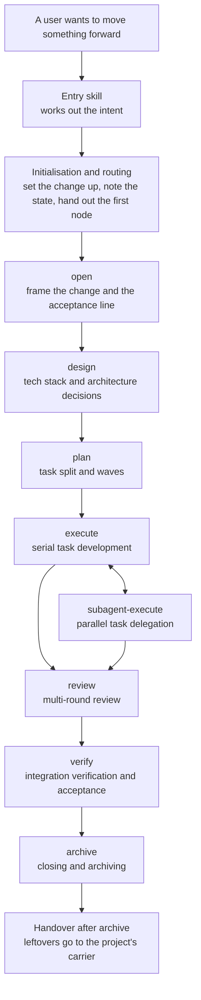
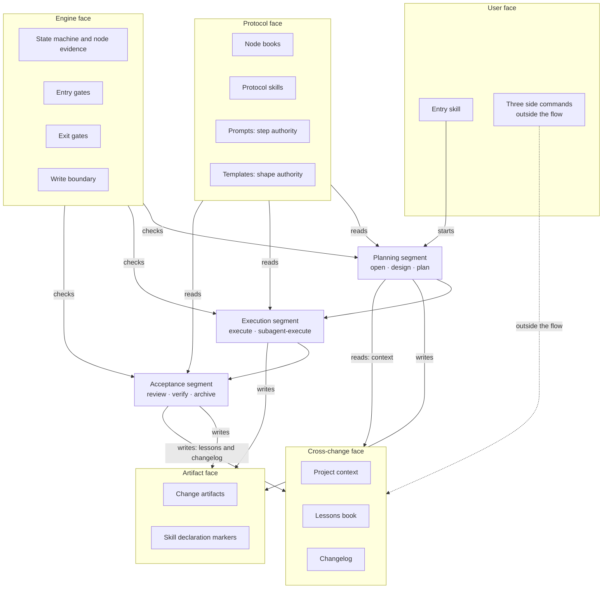
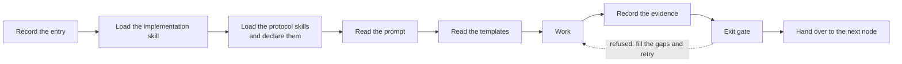
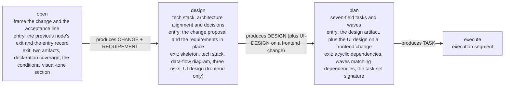
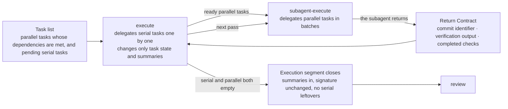
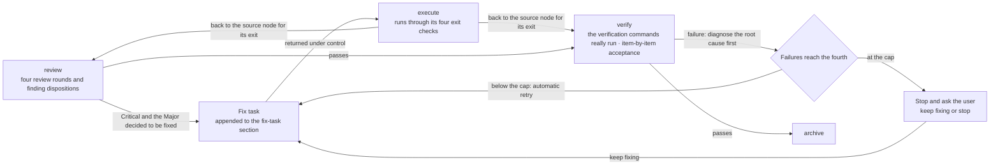
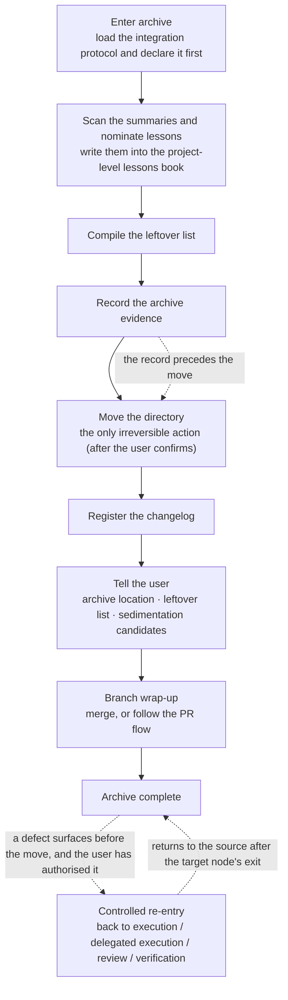

# Workflow reference: the eight nodes

[English](NODES.md) · [中文](NODES-zh.md)

## What this page is

This page walks through flow-comet's eight nodes one node at a time: who loads each node, which prompt and templates it reads, what the agent actually does, what stops it, and where it goes once it is done. It is written for readers who have already decided to run this workflow and want to know what the process decides on their behalf at each step — not a step-by-step command manual.

The three public documents divide the work differently, and it is worth telling them apart before reading. The usage page covers how to drive a node, where artifacts live and which commands to type, and it is the contract authority for the workflow face; the mechanisms page covers what the engine guarantees, how the gates judge and how execution is isolated, and it is the authority for the behaviour face; this page does only the node-level synthesis, laying the node books, the protocol, the prompts and the templates out in one set of columns for comparison. None of the three is the executor's working authority — inside a node the executor really reads the node book and the prompt, and this page exists so a reader can build the right mental model without reading them first.

Read it starting with the shared part, then section by section. The shared part covers the lifecycle every node runs and a few cross-cutting faces: two-layer loading, two authorities, declarations and evidence, the write boundary and the four decision classes. From Node by node onward every node is written in the same columns: responsibility, which skills are loaded, which prompt and templates are read, what the agent does, which artifacts and evidence come out, what the exit checks, and where it stops or where it goes next.

This page gives no task example you could copy outright. Every project's change is different — artifact content, task breakdown and verification commands all follow the project — and writing one run's content into a reference page turns special-case detail into a general rule. What the page gives is the node's own behaviour: what an artifact looks like is settled by the template, and how the work is done is settled by the prompt and the node book.

The eight nodes are the default protocol. Any installed skills can be composed into a custom protocol and driven by the same engine — routing, gates and the write boundary keep their criteria, and what changes is which nodes exist and what each node declares. This page describes only the default eight.

## The shape of the workflow

The shape of the workflow is a main chain plus a back-and-forth in the execution segment. A piece of work starts with the entry skill: initialisation sets a change up and hands routing to the first node; open, design and plan settle why it is done, what is done, how it is done and which tasks it breaks into; the execution segment is carried by execute and subagent-execute — the first works through the serial tasks, the second delegates in batches the parallel tasks whose dependencies are already met, and the two alternate by task state until every task is complete; review, verify and archive then close it out — review disposes of every finding, verify really runs the verification commands and walks the acceptance items one by one, and archive files the change away and sediments the experience outside it.

**Figure 1 · the main chain from the entry to the archive**

Each node in the diagram carries one responsibility phrase, not a set of steps. The two execution-segment nodes are entered several times, which is why that segment is not a straight line; re-entering the same node still runs the whole lifecycle, and arriving again does not let a node skip its entry or its exit.

The node order is a gate, not a suggestion. Until the previous node's artifacts pass its exit, the next node cannot be entered; and routing does not merely move a name one step forward — it re-derives every time which node the artifacts and the task state put you in: the next gate opens only once the upstream artifacts are in place, task state decides which node of the execution segment runs, and review comes only when everything is complete and the summaries are in. So "do a bit of the later work first and come back" does not hold in this workflow; what can be skipped is the style of work inside a node, and what cannot be skipped is the gate.

There is one handover outside the workflow: once the archive exit passes, the leftover list goes to a carrier the project already uses — a step the executor carries out from the skill text, with no gate checking it and no change to the fact that the change is archived.

## The complete architecture

Pulled back, the workflow is five faces stacked: the user face, the protocol face, the engine face, the artifact face and the cross-change face. The user face decides when work starts and whether a side command runs; the protocol face is all the working method and output constraint the executor reads; the engine face is state, gates and the write boundary; the artifact face is the only truth; the cross-change face accumulates outside a single change and is read or written only at that change's start and close.

**Figure 2 · the five faces and the main chain of nodes**

The arrows between the layers carry only three meanings, and reading them is enough to read the whole diagram: protocol face to main chain is "read" — the executor loads skills per node, walks the steps per the prompt and produces per the template; main chain to artifact face is "write" — artifacts and declaration markers land in the change's directory; engine face to main chain is "check", running through both ends, checking the previous node's exit and this entry's conditions on the way in, and artifacts, declarations, evidence and each node's own criteria on the way out. The cross-change face does not appear in every pass; it is read or written only at the boundaries.

### How to read the five layers

The five layers are not five directories but five faces of one thing. Read them once in the order "who starts it, who supplies the method, who keeps the gate, where it lands, and how it accumulates across changes", then go back to the nodes and watch each step cross which layers.

| Face | What it holds | Who reads it |
|---|---|---|
| User face | The entry skill and the three side commands | The user |
| Protocol face | Node books, protocol skills, prompts and templates | The agent executing the node |
| Engine face | The state machine and node evidence, the entry and exit gates, the write boundary | The engine itself; an agent writes only indirectly, through the commands the engine hands out |
| Artifact face | Change artifacts and skill declaration markers | The gates, routing and the next session |
| Cross-change face | Project context, lessons book and changelog | The start and the close of every change |

Read this way, one node pass crosses only the first four layers: the user face gives the start, the protocol face gives the method and the shape, the engine face keeps the gate, and the artifact face keeps the output and the declaration; the cross-change face does not show up in a pass and is touched only when a change starts (reading the context) and archives (nominating lessons, registering the change). The division between the three documents follows from this — the usage page covers the operating face of the first and fourth layers, the mechanisms page covers the criteria of the third, and this page covers how the second and third land on each node.

## What every node shares

The eight nodes do different work, but every step runs the same lifecycle: record the entry, load the implementation skill, load the protocol skills and declare them, read the prompt, read the templates, work, record the evidence, pass the exit gate, hand over to the next node. Two positions in that order cannot be swapped — the declaration must come before any action (load first, declare second, work last), and the evidence must come before an irreversible action (the evidence is recorded before the directory is moved).

**Figure 3 · the lifecycle every node runs**

The entry is not a check-in: the entry check has content of its own — the coordinator prohibition, the checks made before a delegation and the task-set signature are recorded or verified at this step, and aiming straight at the exit while skipping the entry is refused as an unrecorded entry. Nor is the exit a matter of writing a summary: it checks this node's artifacts, the declaration's coverage and the evidence item by item, plus the criteria particular to the node — whether every task is complete, whether every review finding carries a disposition, whether the verification commands really ran and passed — and advances only when all of them hold.

This lifecycle runs once per node, not once per change. The two nodes of the execution segment may go back and forth many times, and every pass runs the whole chain again: re-entered and re-validated, never skipped because a previous pass already came through.

### Two-layer skill loading

Loading a node happens in two layers, and one without the other is not loaded. The first layer is the node's implementation skill: it states what this node does and by what standard it counts as done, it is handed out by the entry when routing arrives, and it has to be brought into effect by loading it as a skill — reading the file is not loading. The second layer is the protocol skills: the method protocols of the phases (framing, requirements, design, UI, tasks, development, test, integration), which the implementation skill declares per node.

A protocol skill only takes effect once it is loaded, and the loading action must leave a declaration: the declaration also spells out every prompt and template this node is supposed to read. Declaration and loading are two different things — the declaration records what you were told to read, and it does not prove you read it; but the exit requires the declaration to cover the node rather than sample it, so every protocol this node reads and every protocol skill its protocol makes mandatory must be declared, and a missing item is named one by one with the way to fill it in, and the node does not pass.

Nodes differ. open and review each need two protocols; design's UI protocol holds only for a frontend change, its criterion coming from the framing artifact's visual-tone section, and a non-frontend change neither loads nor declares it; verify and archive have no templates, so no template list appears in their declarations. For the delegated part the subagent declares its own protocol, and the coordinator does not declare on its behalf.

### Two authorities

Every node's entry hands out two pointers, in a fixed order: the prompt first, the template second. The prompt governs the steps — how many parts this step has, what each part answers, when to stop; the template governs the shape — the artifact's title, header fields, section order and the form each section takes. The division does not overlap, so both are read, and loading is complete only when both are read.

The order is itself meaningful: know how to do it first, then see what the result should look like. A node with no upstream template (verify and archive) gets only the prompt pointer; a node with a template gets both, and a frontend change gets one conditional pointer more — the UI prompt and the UI template, whose criterion comes from the same visual-tone section.

Both authorities are upstream baselines vendored with the package, read-only and unmodified by this repository. Where an upstream prompt and template occasionally disagree on section numbers or on the section list, this repository does not silently follow one side: the entry book and the node books declare, item by item, which upstream wording is not adopted, what is carried over and which one prevails in a conflict; the template stays the shape authority for artifacts, and the prompt stays the step authority. When a template is absent the exit reports "unchecked (template missing)" rather than counting it as passed.

### Declarations and evidence

Both records are written into the state, but they govern different things. The declaration answers what this node was told to read — one per required skill, possibly spread across several loads, and the exit sums them up per node and checks coverage. The evidence answers that this node is finished — a summary stating what was done, the real output of the verification commands and the conclusion of the self-check, optionally carrying the checks declared complete and the lessons nominated; without evidence the exit refuses outright.

Neither can stand in for the artifact: the declaration does not prove reading, the evidence does not prove correctness, and what actually judges an output is the artifact's own skeleton, the existence of the project-level documents and each node's particular criteria. The state holds no conversation either, so the next session can continue from the artifacts and the evidence alone.

A delegation node's evidence takes a different form: it has no artifact of its own, and its evidence is a request-and-result pair; the contract the subagent returns must carry the commit, the real verification output and the checks it declares complete, and a missing item is sent back. The archive node's evidence must also match the nomination record — how many summaries were scanned, which entries were nominated and why when none were; all three must be checkable.

### The write boundary

Every node has a scope it may write in, and a write outside it is refused before it lands: the platform layer resolves the target to a physical path first, then compares it with the current node's whitelist, so a directory link cannot lead an allowed write elsewhere. This layer and the gates divide the work — the gates govern whether the node may advance, the write boundary governs whether this action may land; both have to pass, so there is no "write it first and clean up later".

In the default execution mode the coordinating session may not carry out implementation tasks itself: during a delegation it may write only artifacts and task state, and source changes go to a subagent. The subagent is the executor and is admitted by its task's write set; but the state file and the protocol files form the minimal protected set and are opened to no one — editing them by hand is exactly what distorts the state. The judgement runs on identity rather than on path: once the platform marks the caller as a subagent, subagent semantics apply ahead of any path resolution.

The boundary is not a sandbox: targets inside a script body, an interpreter or command text are not all analysed, and where host permissions allow it a write can still get around. So the accurate statement is that the whitelist bounds the tools you use, not that it seals writes off entirely; the detail of the tool face is in [Usage](USAGE.md#tool-surface-on-dsh).

### Four decision classes

The executor classifies the matter at hand first, then decides whether to stop and ask. A wrong classification has only two outcomes: deciding for the user what should have been asked, or pushing back to the user what should have been done.

| Class | Criterion | Handling |
|---|---|---|
| User decision | Two or more legitimate options that would change scope, behaviour, risk or an irreversible result | Stop and ask; merge adjacent questions and do not re-ask what is settled (at most three questions per round while framing); in a non-interactive session, report it as open and stop |
| Auto-handled | A single safe next step | Do it and report, without manufacturing confirmation |
| Stop condition | A gate failure, a missing dependency or corrupted state | Diagnose first and carry out the single safe repair; escalate to a user decision only when several legitimate ways back exist |
| Manual handover | The action itself is marked as a manual handover | Not a decision: continue without asking the user |

User decisions are not spread evenly; they cluster in a few places: the topic and scope while framing, the tech stack while designing, a breaking change and a data migration while executing, switching to direct execution mode, the handling of a serious finding while reviewing, continuing or stopping after the fourth verification failure, and archiving with its branch wrap-up. What these have in common is that the answer changes scope or an irreversible result, and a wrong guess means rework; nothing else is worth asking.

The line between auto-handled and stop condition is whether there is one safe step: take it if there is, report the blockage and the recovery condition if there is not. Nor is a gate failure automatically a question for the user — diagnose it yourself first, carry out the single safe repair if one exists, and escalate to a user decision only when several legitimate ways back exist or a risk has to be accepted.

One default runs through all four classes: the boundary must be declared. Anything that looks like user authority — a repair round past its cap, re-entering an archived change, the coordinator taking over a task — must be explicit and on the record, and silence counts as refusal. This default is the same in every node and does not loosen because the matter is urgent. The confirmation points listed per node are in the decision-points reference book in the skill tree; each node section below marks only that node's decision points and its next hop.

## Node by node

This section walks the main chain in order — open, design and plan, then the five that follow — and every node is laid out in the same seven columns: responsibility, skills loaded, prompts and templates, what the agent does, artifacts and evidence, exit checks, decisions and the next node. The facts in those columns come from three places with different jobs — the implementation and mandatory protocol skills, the prompts and templates, the artifacts and evidence, and the entry and exit items all follow the protocol and the engine's explain view; how the work is done inside the node follows the node book; the page only synthesises and does not restate the operating steps. Read it by jumping: to know what this node blocks, read responsibility and exit checks; to know why it stops, read decisions and the next node.

### open

#### Responsibility

open frames a vague idea into a change: it asks why, for whom, solving what and when it counts as done, then lands a change proposal and a verifiable requirement document. It is also where two judgements happen — whether this is an architecture-level change, and whether it is a frontend change, the latter deciding whether a UI design is added later. It settles scope and the acceptance line only; it writes no implementation and breaks out no tasks.

#### Skills loaded

- Implementation skill: flow-comet-open, handed out by the entry when routing arrives; it must be brought into effect by loading it as a skill, and reading the file is not loading.
- Two protocol skills: flow-comet-change governs framing (naming, the architecture-level judgement, visual-tone preselection) and flow-comet-requirement governs requirements (acceptance criteria, scope split, terminology into the context). Both are loaded, each leaving one declaration.
- This node has no conditional protocol skill: both hold for every change, and the only variation is whether the framing stage's own steps are run.

#### Prompts and templates

- Prompts, two: 0-change and 1-requirement, read in that order — framing first, requirements second.
- Templates, two: CHANGE and REQUIREMENT, one for each artifact.
- Prompt first, template second; loading is complete only when both templates are present, both declaration records name both templates, and the node-level view takes their union.

#### What the agent does

- Generates the change name: two to four short words from the description, checked against existing directories, given a suffix on a collision, and reported to the user in the first message.
- Detects an architecture-level change on five counts — module structure, conflict with a settled decision, public contract, capacity boundary and cross-service orchestration; a hit stops and lets the user choose among three ways out (build the architecture baseline first, continue with an architecture-impact declaration, re-judge). Most changes miss it, and the user is left alone.
- Identifies a frontend change and preselects the visual tone: a UI clue in the description makes it frontend, and a separate round lets the user pick from tone cards that must offer a preferred option, an alternative and an explicit exclusion; the chosen value goes into the change proposal's visual-tone section. A non-frontend change skips this.
- Asks structured questions — why, for whom, solving what, when done — at most three per round and never assuming on the user's behalf; tone cards and requirement questions never come in the same round.
- Maps the impact and the exclusions: whether requirements move, whether architecture is touched, whether existing acceptance is affected; the exclusions state at least one "not this time", or scope will silently grow later.
- Writes the acceptance criteria: each in given-when-then form and verifiable by one command or one manual action, and one that cannot be written as a single sentence stops the node. Scope splits into v1 / v2 / out, and terminology and settled decisions go into the project context.
- Scans the lessons book on this change's keywords: a hit either declares its difference from the earlier attempt or confirms that the lesson still applies.

#### Artifacts and evidence

- Two artifacts: the change proposal and the requirement document (CHANGE.md, REQUIREMENT.md) under the change directory; the project context gains terminology and settled decisions as needed.
- Evidence: one node summary with the id intake-summary, stating which two artifacts were produced and whether the user confirmed.
- The change proposal's visual-tone section is conditional: a frontend change must carry a value, and a non-frontend change keeps the structural form and marks it not applicable rather than deleting it.

#### Exit checks

- Skeleton and headers of the two artifacts: the change proposal's six sections and the requirement document's five are present and non-empty, and the change identifier in the header is not empty.
- Conditional and structural subsections: the visual-tone heading must be present, and the v1 / v2 / out subsections under the scope split must be present when their parent section applies.
- The project context is checked when it exists; a missing template is reported as "unchecked (template missing)" and not counted as passed.
- Declaration coverage: the declarations for both protocol skills are there, and the prompt and template lists in them are complete.
- Content quality is not judged at this gate: whether the exclusions are enough and whether the context was updated belongs to execution discipline, and review keeps it.

#### Decisions and the next node

- User decisions: clarifying the topic and the scope; on a frontend change, also choosing the visual tone. Naming, the impact judgement and the path advice are auto-handled — do them and report.
- Next: design. The route moves on only once both artifacts pass the exit and the declarations are complete.

### design

#### Responsibility

Turns the requirements into an executable technical design: locks the tech stack, aligns with the existing architecture (which modules are touched, which abstractions are reused, what is out of bounds), and writes decisions with trade-offs, data-flow diagrams, traceable decision records and risks; a frontend change adds a UI design. This node produces design, not implementation code — signatures and pseudocode are fine, and a complete function body is not.

#### Skills loaded

- Implementation skill: flow-comet-design.
- Protocol skills: flow-comet-design (this node's same-named entry loads with the route, and one declaration is written for it); flow-comet-ui-design is the frontend-only conditional entry — a frontend change loads and declares it, and a non-frontend change does neither.
- The UI protocol is not optional but conditional: its criterion comes from the change proposal's visual-tone section, the criterion in full is in the UI design book, and this page does not repeat it.

#### Prompts and templates

- Prompt: 2-design; a frontend change adds 2a-ui-design.
- Template: DESIGN; a frontend change adds UI-DESIGN.
- The UI pair is a conditional pointer: a non-frontend change neither reads nor declares it, and it appears in no declaration list. The order is still prompt first, template second.
- Upstream prompts and templates occasionally disagree on section numbers; this repository follows the template's section names and order and declares in the node book which upstream wording is not adopted.

#### What the agent does

- Runs the architecture-level precheck: what framing already judged is not re-judged, while a change entering design directly is judged again on the same criteria, and when it hits and no architecture baseline exists the user is asked.
- Locks the tech stack: filters a few candidate cards from the requirements and the non-functional needs, offering a preferred option, an alternative and an explicit exclusion, and waits for the user; a settled decision already in the project context is used directly, and a library or command-line project may skip this.
- Aligns with the existing architecture: lists, by verification rather than from memory, the existing modules this change touches, the new modules, the reusable abstractions and the do-not-touch list; for every key capability it asks first whether the existing one will do, and introducing a new pattern has to be justified.
- Writes the decisions list: every decision carries its alternatives, the reason for the choice and the cost of the trade-off; "as per best practice" is not a reason.
- Draws the data flow and the boundary: at least one diagram saying where data or events come from and go to, and which parts are external dependencies or untouched modules.
- Writes traceable decision records: a decision that may be overturned later gets its own record with the background, the decision and the consequences.
- Assesses the risks and the out-of-scope items: at least three risks (implementation, rollout, long-term debt), each with a mitigation; out-of-scope items state explicitly what will not be solved now but will have to be faced later.
- Records the architecture sediment: whether this change leaves a reusable abstraction, a project-level decision, a cross-module contract, a dependency change or a change to the do-not-touch list — fill it in if so, and when there is none write the whole section as no suggestions, without padding.
- Adds the UI design on a frontend change: sets the aesthetic direction and the design tokens (colour, type, spacing, radius, motion, shadow) and runs the anti-pattern self-check.
- Scans the lessons book on the modules and technical decisions it touches; a hit declares its difference or confirms that the lesson still applies.

#### Artifacts and evidence

- Main artifact: the design document (DESIGN.md; a lightweight run may write DESIGN-lite.md), whose first section on the tech stack must be filled in completely.
- A frontend change also has a UI design (UI-DESIGN.md) holding the design tokens; traceable decision records are written as needed under the project's decision directory.
- Evidence: one node summary with the id design-summary; on a frontend change the summary also states explicitly that the UI design skill's declaration is complete.

#### Exit checks

- Skeleton: tech stack, decisions list, data flow and architecture diagrams, risks and not in scope — five unconditional sections; the existing-architecture alignment, the key state machine, the decision-record index and the architecture-sediment suggestions are four headings that must be present, writing not applicable where they do not apply.
- The tech-stack section must be filled in completely (frontend, backend, database, deployment, key dependencies, reasons and explicit exclusions), or the tasks' verification commands and directory structure have nothing to align with.
- The three subsections of the existing-architecture alignment must be present when their parent section applies; at least one data-flow diagram; at least three risks; out of scope must be written.
- The UI design is checked whenever it exists: a frontend change missing it is hard-blocked, while a non-frontend change passes and the exit prints the skip explicitly rather than passing silently.
- Declaration coverage: a non-frontend change has one declaration, a frontend change has both, and the template list agrees with the frontend applicability.
- Whether the write set is out of bounds and the alignment detailed enough belongs to execution discipline, and review keeps it.

#### Decisions and the next node

- User decisions: the tech stack (used directly once settled in the context, without re-asking); the three options when an architecture-level change lacks an architecture baseline.
- Next: plan. Once the design passes its exit, the route hands out the task breakdown.

### plan

#### Responsibility

Breaks the design into executable atomic tasks: each task has a read boundary, a write boundary, one command that can be run as verification, one completion criterion and its dependencies stated explicitly. Waves are not layout but the execution order projected from the dependency levels, and the execution segment takes its passes from them, delegating in batches only the parallel tasks whose dependencies are already met.

#### Skills loaded

- Implementation skill: flow-comet-plan.
- One protocol skill: flow-comet-task, governing the task breakdown, the waves and the boundary rules. It loads with the route and leaves one declaration naming the prompt and template this node reads.

#### Prompts and templates

- Prompt: 3-task.
- Template: TASK.
- The upstream prompt's rule on parallelism is looser than this repository's (parallel whenever there is no conflict, one wave whenever on the same level), and that part is not adopted: parallel marks and waves follow the node book's constraints, and the upstream file stays read-only and unmodified.

#### What the agent does

- Passes the precondition gate first: both upstream artifacts, the requirement and the design, must be in place, and a frontend change also needs the UI design. One missing sends the work back to the previous node — no inventing a tech stack, touched modules, do-not-touch list or write boundary.
- Reads the tech stack and the boundaries: the tech-stack section settles the verification commands, the dependency management and the directory structure, while the existing-architecture alignment settles which files may be written and which are out of bounds.
- Slices vertically, by file conflict rather than by layer: a task is one feature line cutting through the layers, not "all the models first, then all the interfaces"; one file belongs to one task, and where a split is unavoidable the order and the reason are written down.
- Marks parallelism: only a task that really has a concurrent companion in the same wave and a write set that does not overlap is marked parallel, and an isolated task is always serial. Parallelism also requires four conditions — write permission, commit isolation, verification isolation and integration discipline; a worktree is one implementation of the first, not the premise.
- Declares the dependencies: every task states its dependencies explicitly, and a task without one leaves an empty declaration; dependencies must not form a cycle or point at a task that does not exist.
- Completes the seven fields — name, read set, write set, action, verification, completion criterion and dependencies, none missing; the task identifier is an attribute of the task block, not a field. The write boundary must not leave the design's touch and new modules and must not contain the do-not-touch list — the same line as the change-scope check before a commit.
- Assigns the waves: a task's wave is one past the latest wave among its dependencies, and no dependency means the first wave; tasks in the same wave must not depend on one another. To make a task run later, declare the dependency rather than moving it to a later wave without one.
- Scans the lessons book on the planned files and actions; a hit declares its difference or confirms that the lesson still applies.

#### Artifacts and evidence

- The only artifact: the task list (TASK.md), holding the wave plan, the task blocks, the status-field notes, the blocking log and the fix-task area left for the review stage to fill in.
- Evidence: one node summary with the id plan-summary, stating the number of tasks, the number of waves and the number of parallel tasks; a summary does not replace the fields in the task blocks.

#### Exit checks

- At least one task block; the seven fields present in every task; every task has a runnable verification rather than a description such as "tests pass".
- The task graph: acyclic dependencies, and no dependency pointing at a non-existent task; parallel tasks' write sets do not overlap — that one only warns, but an overlap still has to be fixed.
- Waves agree with the dependency levels: a disagreement is listed task by task with its dependencies, the declared wave and the wave it should reach, plus two ways out — move it to that wave, or add the dependency that explains the order. With no wave section the rule is reported as "unchecked (no wave section)" and skipped, while a section present that yields no line naming a real task is judged undecidable and blocked; every non-fix task must be covered by some wave line.
- The exit also computes the task set into a signature and records it, so the execution segment can tell whether the task set has been changed.
- Skeleton and header: all five sections present; once a header field appears it must not be empty.
- Whether the write set is out of bounds and the parallel marks necessary belongs to execution discipline, and review keeps it.

#### Decisions and the next node

- No user decisions: the split and the order follow from the dependency graph and need no sign-off.
- Next: execute; if this wave already holds parallel tasks whose dependencies are met, routing goes first to subagent-execute to delegate them in a batch, and then back to execute to consume the serial part.
- "This task feels like it should run later" is not a decision: that is what a dependency declaration is for, and putting it on a wave line is refused at the exit.

**Figure 4 · the three planning nodes and the gate at each step**

### execute

#### Responsibility

execute is half of the execution segment: it works through the tasks in the task list whose dependencies are already met and which are not marked parallel, one by one, until no serial task is left. By default it is not the one writing code but the coordinator — tasks go to subagents in fresh contexts, each running the development protocol through; only when the user explicitly switches to direct mode does the main agent do the work itself. Parallel tasks are not its business, and subagent-execute delegates those in batches; the two nodes alternate by task state until everything is complete.

#### Skills loaded

- Implementation skill: flow-comet-execute, arriving with the route; it must be brought into effect by loading it as a skill, and reading the file is not loading.
- One protocol skill: flow-comet-dev, governing test-first, the six-dimension self-check, the boundary check, atomic commits and the lessons scan. In the default mode each delegated subagent loads it in its own session and returns proof, and the coordinator records only this node's one declaration; in direct mode the main agent loads and runs it itself.
- This node has no conditionally valid protocol skill: the development protocol holds for every task, and only who executes it differs.

#### Prompts and templates

- Prompt: 4-dev. It is the working protocol every task really follows and must be handed to the subagent as it is when delegating — "see the previous summary" is no substitute.
- Template: SUMMARY, one per completed task.
- Beyond the summary template this repository registers two further sections — the self-check method and the lessons scan. They are not in the upstream template, and the template read must cover where they go, or a returned summary is refused at the exit for a missing section.
- Prompt first, template second; the declaration names this pair in full.

#### What the agent does

- Proceeds by execution mode: by default it delegates the pending serial tasks one at a time to subagents in fresh contexts; direct mode is the escape hatch and the user must switch it explicitly, after which the main agent still walks test-first, the six-dimension self-check, the boundary check and atomic commits per the development protocol.
- Registers the delegation before starting the subagent: for one task these are two serial actions and cannot be folded into a single concurrent call. The delegation carries the task block verbatim, the design's tech-stack and existing-architecture alignment sections, the relevant acceptance criteria and the read and write boundaries.
- The coordinator touches only three things: task state, the task summary and the delegation record. Source changes are always left to the subagent — never written on its behalf, never fixed on the side in the coordinating session; a dispatch failure is recorded as blocked and follows recovery, and implementation is not taken over.
- Accepts each returned task on its own: the summary's skeleton, header and section order match the template, the self-check method and lessons-scan sections are present, the verification output was really produced, and the six-dimension self-check and boundary check have substance; only then is the task marked complete in the task list.
- Skips the parallel tasks: a pending task marked parallel does not belong here and goes to subagent-execute, and this node passes over it instead of doing it on the spot.
- Remembers the task-set signature: it computes one on entry and may change only a task's completion state in between; adding or removing tasks, or changing an action or a boundary, makes the signature disagree, the exit blocks and a controlled replan follows — never a hand edit of the state.
- Takes the proper path even when everything is parallel: with no serial work the route should go straight to subagent-execute, and if this node is entered and holds no serial task it declares an empty exit explicitly rather than exiting silently, and certainly does not use the occasion to do the parallel tasks.

#### Artifacts and evidence

- One task summary per completed task under the change directory, and the corresponding task's state in the task list updates with it. A summary does not replace the task block's fields, but it is the proof that the task was really done.
- Evidence: one execution summary with the id implementation-summary, stating which tasks this node completed and whether direct mode was used.
- A missing summary or an empty skeleton means no output: the exit will not accept a verbal report in its place.

#### Exit checks

- Serial leftovers: a pending serial task blocks, and a parallel-marked task done by this node is blocked as an over-authorised delegation.
- Summary completeness: every completed task has a summary, with the skeleton, header and section order matching the template, the self-check method declared as one of the three values and the lessons-scan section present; how well it is written is not judged here.
- Task-set signature agreement: compared with the one computed on entry, and a task added, removed or changed is blocked with the pointer to a controlled replan.
- Empty exit: with every task parallel the node may not exit empty; when there really is no serial work it declares the empty exit explicitly, the exit passes and leaves one audit note — the default is still to block.
- A missing template is reported as unchecked rather than passed, and the entry artifacts (change proposal, requirement document, design document) are checked when they exist.

#### Decisions and the next node

- User decisions: a breaking change (deletion or change scale, or a public interface at the line), whether a data migration runs now, and whether to switch to direct mode. Nothing else is asked, and the execution order follows the task list.
- Next: if parallel tasks whose dependencies are met remain, go to subagent-execute; only when serial and parallel are both empty and the summaries are in does review come up.

### subagent-execute

#### Responsibility

subagent-execute is the other half of the execution segment: it delegates in batches the parallel tasks whose dependencies are already met, collects the returns and marks them complete after acceptance. It produces no implementation, only organises execution — the main session is the coordinator and the source is always written by subagents. The execution segment alternates between it and execute: one pass consumes a batch of parallel tasks, and between passes execute consumes the serial ones, until both are empty.

#### Skills loaded

- Implementation skill: flow-comet-subagent-execute.
- One protocol skill: flow-comet-dev, which at this node is the delegated scope — the coordinator loads it and records it in the declaration, and the subagent that actually runs a task loads it again in its own session and returns proof. The coordinator does not declare for the subagent.
- No conditional protocol skill: every parallel task runs the full development protocol.

#### Prompts and templates

- Prompt: 4-dev; template: SUMMARY, one per task that is delegated and completed.
- The delegation prompt names both pointers: before starting, the subagent reads the prompt, then the output template, fills it per title, header and section order, and adds the two sections this repository registers.
- Writing only "fill it per the template" does not count as the pre-delegation check, and the prompt and template pointers are given per task.

#### What the agent does

- Picks only parallel tasks whose dependencies are met: marked parallel in the task block, still pending, with write sets that do not overlap; overlapping write sets are not dispatched in parallel, and the order is expressed through the task list's dependencies first.
- Coordinator prohibition: the main session writes no source and does no implementation; a failed dispatch is recorded as blocked with a recovery condition, and implementation is not taken over. The only things the coordinator may update are task state, task summaries and delegation records.
- Registers a delegation request per task, and the request succeeds before the subagent starts — for one task these two steps are serial and cannot be folded into one concurrent call.
- The delegation content is fixed: the task block verbatim, the design's tech-stack and existing-architecture alignment sections, the relevant acceptance criteria, the read and write boundaries, and the explicit demand to load the development protocol as a skill, follow the prompt, write the summary per the template and return the contract.
- Shared workspace and write boundaries: several subagents may sit in one workspace and isolate themselves by write-set exclusion and commit timing; a commit carries only the literal paths in its own write set, and carrying along someone else's change or an artifact the coordinator maintains is blocked on return.
- Collects the returns and records them one by one, marking completion together after they are all back; control then goes back to routing for the next pass.
- Multi-pass: each pass dispatches only the parallel tasks ready at that moment, and the execution segment closes only when no ready parallel task and no serial leftover remain.

#### Artifacts and evidence

- No artifact of its own. The evidence is a pair of records: a delegation request per task (id handoff-request) and a returned result (id handoff-result).
- The result must carry three things — the commit identifier, the real verification output and the checks it declares complete, that is the Return Contract; a task that is pure documentation or produces no code change may state honestly that there is no corresponding test, rather than dropping the field.
- The task summary is still produced by the subagent and lands in the change directory; the coordinator uses it for acceptance and not as a substitute for evidence.

#### Exit checks

- In-flight delegations: a request without a matching result blocks; a withdrawn request is not in flight, and the withdrawal is on the record with the history kept.
- A Return Contract item missing sends it back: the commit identifier, the verification output and the completed checks. The checks are named per this node's uniform contract, and a wrong name is judged the same as a protocol never loaded.
- Write boundary: a returned commit that leaves the task's write set is blocked, and a commit carrying along the task list the coordinator maintains is blocked too.
- The summary is present and matches the template: every delegated and completed task has its own summary.
- Parallel only: a serial task delegated by this node is an over-authorised delegation, blocked, with the task sent back to execute.

#### Decisions and the next node

- No user decisions: which tasks to dispatch and in how many passes follows from the dependency graph and the task state, and needs no sign-off.
- Next: with serial leftovers, back to execute; when both are empty, on to review.
- A dispatch failure is not a user decision: record the blockage and give the recovery condition, rather than turning "who writes it" into a question.

**Figure 5 · the two execution nodes and the multi-pass round trip**

### review

#### Responsibility

review is the quality gate before merging: it checks implementation, tests and UI together, confirms that every acceptance criterion is really met, that no round of the test pyramid is missing and that the code brings no debt into the trunk, then tags every finding with a severity and a disposition. It produces only a report and fix tasks and changes no code — a finding that needs fixing goes back into the execution node's lifecycle. Review runs in four rounds — specification compliance, contract consistency, the six dimensions of code quality and UI visuals (frontend only) — plus two supplementary reviews added when their trigger holds.

#### Skills loaded

- Implementation skill: flow-comet-review.
- Two protocol skills: flow-comet-review (the same-named entry loads with the route and only needs its declaration written) and flow-comet-test (governing the completeness of the test pyramid, loaded and declared).
- Both need a declaration; reading a file is not loading, and a declaration is not proof of output.

#### Prompts and templates

- Prompts, two: 6-review and 5-test — the first governs the review method, the second the criteria for test completeness.
- Templates, two: REVIEW and TEST; the review report uses REVIEW and the test document it examines uses TEST.
- Prompt first, template second; both are named in full in the declaration, and a missing one is blocked as incomplete coverage.

#### What the agent does

- First round, specification compliance: every acceptance criterion is checked against the implementation, the tests and the scope; an implementation beyond the scope, an unplanned feature and an architecture that crossed the design all become findings.
- Contract consistency: a change that touches interfaces, state machines or form validation must align the enumerated values, field names and validation rules on both sides item by item; a mismatch is recorded as Major with the locations on both sides.
- Six dimensions of code quality: cognitive overload, change propagation, knowledge duplication, accidental complexity, dependency confusion and domain distortion. The book-driven review tool is preferred and its output is pasted into the report as it is; when the tool is unavailable, self-diagnose on four elements — symptom, source, consequence, remedy — and declare the degradation honestly.
- UI visuals hold only for a frontend change: design tokens, the anti-pattern sweep, the visual north star and a quick accessibility pass; a non-frontend change skips it explicitly rather than writing "not checked".
- Test-pyramid completeness is checked first: whether the five rounds' states are explicit, whether a skipped round has a reason and whether the first round has a row for every acceptance criterion; a missing item is Critical, and the tests are completed before the review goes on.
- Severity and disposition: every finding gets a severity — when in doubt, Major — and then a disposition marker (fixed, escalated, deferred). A deferral is a user decision whatever its severity: mark it escalated and wait for the ruling, and only turn it into a deferred item once the user accepts; Minor requires all five criteria and one sentence of reasoning in the entry.
- Fix tasks go into the task list's fix-task section, not the end of the file; the work is then returned to the execution node under control, runs its four exit checks and comes back.
- Acceptance-criteria coverage prints only a summary line at this exit and does not change the exit code; the authoritative verdict on a real gap is at the verify exit, where a missing row is blocked.

#### Artifacts and evidence

- Main artifact: the review report (REVIEW.md). Critical findings and the Major ones decided to be fixed become fix tasks, appended to the task list's fix-task section.
- Evidence: one node summary with the id review-summary, stating the distribution of finding severities, how many fix tasks were created and the overall conclusion.
- The report does not stand in for location and marker: an entry with no severity, no location and no disposition marker counts as not recorded.

#### Exit checks

- Skeleton: the unconditional sections of both rounds are present; the conditional sections (the UI round, the supplementary rounds) must have their headings present, writing not applicable where they do not apply, and a header field once present must not be empty.
- Finding dispositions: every finding has a disposition marker; a deferred one without a recorded user ruling is blocked, and a Minor entry without its reasoning is blocked too.
- A finding newly discovered inside the fix loop may only be fixed or escalated, never deferred — that rests on execution discipline, and the gate only checks that the marker is there.
- The test-pyramid completeness section is present; the reviewer changes no code, and a change goes back through the execution node's fix loop.
- Acceptance-criteria coverage prints one summary line and does not change the exit code; what cannot be judged splits in two — a missing template is reported as unchecked, and only undecidable content blocks.
- Fix tasks created but not yet run through the execution node's exit mean this node does not pass.

#### Decisions and the next node

- User decisions: how a Critical finding is handled (fix or accept), and any deferral. A dispute over scope or naming is not settled here.
- Next: verify. With a Critical or a Major decided to be fixed, the work goes first through the fix loop back to the execution node, runs its four exit checks, returns to this node to close out, and only then does verification come up.

### verify

#### Responsibility

verify is the last gate before archiving: it really runs the verification commands in the test document, then walks the acceptance script with the user item by item and records every result; any failure is diagnosed for its root cause first and then becomes a fix task back to the execution node. It redesigns nothing and changes no implementation, and only decides whether this version can ship. The node has no template: it reads the prompt, not a template.

#### Skills loaded

- Implementation skill: flow-comet-verify.
- One protocol skill: flow-comet-integration, governing integration verification, acceptance execution, failure diagnosis and lessons nomination; it is loaded and declared.
- No conditional protocol skill; no template list appears in the declaration.

#### Prompts and templates

- Prompt: 7-integration.
- Template: none. This node has no template: it reads the prompt, not a template; the test document's shape is settled by the upstream template together with the verification-command section this repository registers, and the acceptance record has no upstream template and is checked for existence only.
- The declaration carries no template list; naming one template too many disagrees with the node mapping and is blocked.

#### What the agent does

- Runs the whole automated set: unit tests, integration and end-to-end, type checking and the build, pasting the real output item by item; any failure turns to diagnosis at once, and the node does not carry on because "it was green last time".
- Walks the acceptance items: tells the user the scenario, the preconditions, the steps and the expectation, waits for pass, fail or a description of the problem, and records it item by item; it may not judge a pass on the user's behalf.
- Diagnoses failures: find the root cause first, not the symptom; a fix becomes a fix task with complete fields, appended to the task list's fix-task section, and the work then returns to the execution node under control, runs its four exit checks and comes back to re-run.
- Retry limit: automatic retries for one change are capped at three, and the machine counts the failures; the fourth failure must stop and ask the user whether to keep fixing or to stop, with no further automatic retry.
- Nominates lessons: scans the decisions-and-deviations sections of every task summary and the excluded approaches in the leftover progress records, filtered by three criteria — more than half an hour spent debugging, a cause spanning tasks and a fair chance of being retried within six months; only qualifying entries enter the lessons book, and with none the scan itself is the deliverable, without padding.
- The verification command is this node's hardest criterion: the commands in the test document's verification-command section are really executed by the exit and their failures counted — reading them through is not a pass.

#### Artifacts and evidence

- Two artifacts: the test document (TEST.md, usually already present upstream and checked here against its verification-command section) and the acceptance record (UAT.md, recording each result).
- The lessons book is updated when qualifying entries exist; with none, completing the scan is the whole answer.
- Evidence: one node summary with the id verification-result, stating the automated conclusion, the per-item acceptance results and the lessons nominated.

#### Exit checks

- The test document and the acceptance record are both present; the test document's five-round skeleton is checked against the registry, and a conditional round written as not applicable passes.
- The verification commands really run and all pass; a failure count past the limit without stopping to ask the user is blocked.
- Acceptance-criteria coverage is a hard gate: a missing row in the test matrix is blocked with the rows to add; what cannot be judged splits by cause into two — a missing template is reported as unchecked without changing the exit code, while undecidable content (the carrying section or the carrier file cannot be read) still blocks.
- Lessons-book entry form: ids sit in the entry area in ascending order, and a wrong form is blocked; whether there are qualifying entries is the executor's judgement and is checked again at archive.
- The acceptance record is checked for existence only; how well it is written is for the acceptance execution and the review to judge.

#### Decisions and the next node

- User decisions: whether to keep fixing or stop after the fourth failure; beyond that, only the user's own ruling on an acceptance item.
- A failure returning is not a question: diagnose first, create the fix task, return to the execution node — the user need not decide whether to fix.
- Next: archive. Only with the verification commands all green, every acceptance item carrying a result and the lessons nomination accounted for does archiving come up.

**Figure 6 · the acceptance segment and the fix loop**

### archive

#### Responsibility

archive closes out a completed change: it nominates reusable experience into the project-level lessons book, compiles the leftovers into a list, moves the artifacts into the archive area, registers the entry in the changelog and tells the user the result. It is also the only node with an irreversible action — once the directory has moved, the artifacts never return to the active path. The node has no template: it reads the prompt, not a template.

#### Skills loaded

- Implementation skill: flow-comet-archive.
- One protocol skill: flow-comet-integration, governing the criteria for lesson nomination and the order of archiving; it is loaded and declared right after entry, before any action.
- No template list appears in the declaration.

#### Prompts and templates

- Prompt: 7-integration.
- Template: none. This node has no template: it reads the prompt, not a template; when the leftover list needs a skeleton, it reads the template in the reference book, not an upstream output template.
- The declaration must come before the action, especially before the move; declaring after the move is a recovery path only, not the prescribed order.

#### What the agent does

- Declares first, then acts: only after the integration protocol is loaded and the declaration written does it scan the summaries, nominate lessons and write them into the lessons book.
- Compiles the leftover list: the deferred findings and known limitations go into one list, each saying why it was deferred and where it may surface again; with nothing left over, it writes "no leftovers" explicitly.
- Records the evidence: the archive evidence is recorded, the last evidence action before the move, and both the record and the leftover list must be in place before the directory moves.
- Moves the directory: the change directory moves into the archive area with the archive date as its prefix; this is the node's only irreversible action and needs the user's confirmation.
- Registers the changelog: inserts this change's entry at the top of the project changelog in reverse date order, with a summary, the links and the new lesson numbers; the project's existing format wins, and old entries are not re-sorted for uniformity.
- Tells the user: the archive location, the leftover list item by item, the architecture-sediment candidates and the suggested time to sediment them; the leftover list must not vanish after archiving.
- Wraps up the branch: in branch mode, merges back to the default branch and deletes the merged branch; where a PR review was opened, pushes the branch, opens the PR and merges after approval; conflicts go to the user and are not resolved automatically.
- A defect found after archiving: only when the move has not happened, the change is not complete and the user has explicitly authorised it may the work ownership be returned under control to exactly one of execution, delegated execution, review or verification; every such return needs explicit authorisation, the rounds are capped and going past the cap needs an explicit extension; where the directory has moved or the change is complete, re-entry is refused and the matter goes to manual handling or a new change.

#### Artifacts and evidence

- The archive directory (holding all the artifacts and the leftover list) and the changelog's new entry; the lessons book is updated as needed and does not move with the change — it is a permanent project-level file.
- Evidence: one node summary with the id archive-summary; it must match the nomination record — how many summaries were scanned, which entries were nominated and why when none were.
- No template does not mean no criterion: the evidence is checked through the nomination record and the state transition, not through a template skeleton.

#### Exit checks

- The archive directory is present and the active directory is gone; the leftover list sits in the archive directory with the artifacts.
- The lessons nomination record matches the number of summaries; the lessons-book entries are well formed.
- The changelog has a new entry with its table rows in reverse date order; when this change's identifier is missing it only hints at the registration and does not change the exit code.
- The move is a precondition of the exit: with no archive directory in place, the artifact gate blocks outright.
- The state transition completes before the change counts as complete; passing the exit means the archive is closed, and later handling of the leftover list does not block it.

#### Decisions and the next node

- User decisions: archiving is irreversible (confirmation required), whether the leftovers are accepted as known limitations, and whether the branch merge and the PR are carried out.
- Next: there is no next node — the change completes here. The handover after archive is carried out by the executor from the skill text, checked by no gate and with no change to the fact that the change is archived.
- Controlled re-entry is the only edge back: the entry condition is that the move has not happened, the change is not complete and the user has explicitly authorised it; a moved or completed change can only go to manual handling or a new change.

**Figure 7 · the closing segment and cross-change sedimentation**

## How nodes loop

The main chain looks like one line, but several places go backwards: the two execution nodes alternate over several passes by task state; a defect that review or verify finds goes back to the execution node and then to the source node; a verification failure past the automatic retry limit goes to a human ruling; a plan proven defective is re-signed, and a defect found before the archive move has one controlled edge back. This section covers their triggers, paths, rechecks and where they stop.

### Multi-pass execution

The execution segment is never finished in one entry. As long as the task list holds a parallel task whose dependencies are met, routing hands control to the delegation node; after a batch returns it judges again, and if a ready parallel task remains it takes another delegation pass, while a serial task sends it back to the serial node for one pass, and then it judges once more. The round trip converges naturally: with no pending task and no delegation in flight, the execution segment closes.

Every pass is a complete round trip, not a continuation of the previous one. Entry rechecks the entry conditions and the task-set signature, delegations are registered again one by one, and the exit rechecks in-flight delegations, over-authorised work, summaries and leftovers; records left by the previous pass are no pass for this one, and no node skips its own entry or exit.

The recheck looks only at the present: the delegation node's exit asks whether anything is in flight, whether a parallel task was kept and done at this node, and whether every returned task has its own summary; the serial node's exit also asks about serial leftovers and whether the task-set signature still matches entry. The number of passes has no fixed cap — the task list itself supplies it; the real signals to stop are a failed dispatch, state and artifacts that do not line up, or a task set that must be revised — the first two are recorded as blocked with a recovery condition, and the last turns into a controlled replan rather than forcing the round trip.

### The fix loop

It triggers in two places: review finding a Critical or a Major decided to be fixed, and a verification command failing at verify. Either way the repair is not done on the spot at the source node: it first becomes a fix task with complete fields, appended to the task list's fix-task section, and the engine then returns the work ownership to the execution node under control.

The path is a closed six steps: append the fix task, return to the execution node, carry the fix out through the execution node's lifecycle, run the execution node's four exit checks, return to the source node and re-enter and re-exit it, and continue routing once it passes. The return is explicit — the source node's artifacts are long in place, yet it is not skipped for that; it runs its entry and exit again before handing control on.

The exit rechecks on two things. The execution node checks, as usual, that every task is complete, the summaries are in place, the self-check and the lessons scan are present and the task-set signature matches; the audit line, meanwhile, separates a real fix round trip from an ordinary multi-pass close-out and from a controlled re-entry, so the log shows which one this return was. A finding newly discovered inside the fix loop may only be fixed or escalated and never deferred — that rests on execution discipline, and the gate only checks that the marker is there.

When must it stop and ask: when the fix would change scope, touch the requirements or the design, or accept a known risk. Repair rounds are not counted separately inside the loop: fixes coming from the verify side are covered by that node's automatic retry limit, and fixes coming from the review side are handled finding by finding with no fixed count; if the root cause is a task split or a wrongly defined verification, the right move is to judge a controlled replan first, not to keep spending retries inside the loop.

### The retry limit

Only the verify node counts retries: a verification command fails, a fix task returns to the execution node, the fix completes and comes back to verify for a re-run — that whole circle is one retry. Automatic retries are capped at three, the machine counts them and the count survives across sessions; every retry runs the full fix loop rather than simply re-running the command inside this node.

At the line it goes to a human: the fourth failure must stop and ask whether to keep fixing or to stop, with no further automatic retry. That is a user decision, not a gate failure, so "carry out the single safe next step" does not apply; when the user says continue, a new round begins and the count restarts, and when the user says stop, the change stops at the verify node with the defect, the current state and the fixes already tried written into the acceptance record.

At the exit recheck the verify exit really runs the verification commands and checks that they all pass; a failure count past the limit that is still auto-retrying, or a stop that should have been asked for and was not, is blocked. The count is isolated per change, so another change's failures in the same project do not count against this one.

Retries are not a cure-all: if every round's failure points at the same plan defect, retrying just runs the same mistake again; fix the task set and the verification first, then talk about retrying, and when necessary judge a controlled replan.

### Controlled replan

The trigger is a plan proven defective in execution: the task split does not hold, the dependencies are misordered, parallel write sets conflict, a task's verification is wrongly defined — the task set therefore needs revision, and the exit reports its signature disagreeing with the one from entry. It is available only inside the execution segment's two node phases, skips no node and resets no state already completed.

Every replan needs explicit user authorisation, with the source and the reason on the record; before rewriting anything a state snapshot is taken and fingerprinted. A replan does two things only: re-validate on the same criteria as the plan exit, then re-sign the task set. It waives no check — a task block, a per-task verification, a dependency cycle, a missing dependency or a parallel write-set conflict still blocks if it does not hold, while a read/write overlap only warns.

The cap is three rounds per change. The fourth is blocked with a human ruling on whether to continue or stop; continuing needs an explicit extension and the round must advance — a missing authorisation, an empty reason or a round that does not advance is blocked with the state unchanged. A repeated call of the same shape is a no-op, with no backup and no count.

After a replan the execution node's exit checks against the new signature. Its job is to turn a mismatch back into a match, not to get around the signature gate; if what actually needs revising is the design or the requirements, a replan does not apply — go back to the corresponding node to fill it in, or open a new change.

### Controlled re-entry after archive

Its trigger is the latest of all: the change has entered the archive node and the archive move has not happened, when a defect surfaces that can only be fixed by going back into an existing lifecycle. It is the only edge back out of the archive source, and its target is exactly one of four — execution, delegated execution, review, verification.

The path has two constraints. First, every time needs explicit user authorisation, with the source and the reason on the record; before the transfer a state snapshot is taken and fingerprinted for review checks and manual rollback. Second, the order is fixed — transfer first, then write the fix: write permission follows the target node, and the archive phase allows only the leftover list and a few project-level records, so changing the task list during the archive phase cannot land and the transfer must happen first.

The cap is likewise three rounds per change, the fourth needs a human ruling, and continuing needs an explicit extension. Two situations are never accepted for re-entry: the archive move has already happened, or the change is already complete — then only manual handling, a new change or a hotfix applies, and the page promises nothing about putting back what has already been moved.

A re-entry changes work ownership only; it writes no closing marker and skips neither the target node's entry and exit nor the source node's exit gate; back in the flow it still adds tasks through the fix loop, does the work and closes out at the source node. A repeated call with the same target is a no-op and is not silently skipped.

## Beyond the eight nodes

The eight nodes are the kernel of the flow, but not all of it. Outside the flow there are the three side commands, the project context that initialisation sets up, and the ability to assemble any installed skills into a custom protocol; none of the three changes the criteria inside the eight nodes — they only let the same engine serve more situations.

### The three side commands

The three side commands — architecture sedimentation, health check and context rescan — work on the project as a whole rather than on one change, so they take no part in routing, pass no node's entry or exit gate and record no node evidence. None of them is triggered by the flow itself: you invoke all three explicitly, and the ones that write are confirmed item by item.

Architecture sedimentation scans the architecture-sediment section of archived changes' design documents, reading that section only, so a decision frozen at the change level is not mistaken for a project-level upgrade; it produces a candidate list, writes to the project-level documents only after each candidate is confirmed, and leaves a dated sedimentation report. Writes append and never delete; where an existing architecture decision would have to be overturned, it stops and points at an architecture re-review.

The health check starts from a deterministic collector producing a dated health report covering context consistency, the numbering continuity of the lessons entries, the number of tech-debt entries, whether the redundancy tool is present and version-history statistics; when the code-health tool is present its four-dimension result is folded into the same report with its source named, and when it is absent an explicit degradation line is kept instead of filling the gap with a subjective score. The context rescan re-runs the probe, compares it with the previous scan baseline item by item for what appeared, disappeared and changed, refreshes the scan time and leaves a dated scan report.

The boundary all three share is "report, do not advance": they record no progress and cannot stand in for a node's artifacts, so they are no shortcut past a gate either; they decide nothing for the user, open no change and change no business code — whether to take something up is a separate decision. The due reminder in the status view is advice only and runs no command by itself.

### Initialisation and project context

Initialisation sets up more than directories: before every new change the engine probes the project context — whether the context document exists, whether the scan is fresh enough, whether the project already has an AI context document and what signals the code itself gives — then prompts or stays silent on the verdict. Existing and fresh means complete silence; stale means an offer to re-run and refresh; missing means an offer to initialise, with both the accept and the decline paths given.

The context document has seven fixed sections: project summary, tech stack, domain language, settled decisions, default preferences, the existing-abstractions index and scan metadata. The deterministic part is the script's — probing, judging, prompting, validating the seven sections and writing the scan time; generation is the agent's, which reads the existing documents and the code in full, marks the source of everything it folds in, and writes nothing to the existing documents themselves.

It accumulates across changes: a refresh keeps the existing terminology and settled decisions, so a rescan loses no section; several changes' terminology flows into one domain language, and decisions are appended by date with their source noted. It is also the only document in the cross-change face that nodes read and write by themselves — a node reads it at the start and writes back what can be sedimented at the close.

A decline is on the record too: once the skip is recorded, later initialisations do not prompt again; a skip is not a refusal but a note that the matter is known and decided against. The context document is not a workflow artifact: it does not go into the change directory and does not archive with the change.

### Custom protocols

The eight nodes are the default protocol, not the only one. Protocol composition assembles any installed skills into one protocol file and hands it to the same engine: the node sequence and transitions, the entry and exit gates and the write boundary all follow the declaration, with no new runtime capability required.

A protocol declares at least its nodes, each node's implementation skill, each node's outputs and each output's evidence; every node must have artifacts and evidence, and node ids must not reuse the built-in eight — without artifacts there is nothing to validate or recover from. The write whitelist may be declared explicitly and supports the change identifier as a placeholder, so one protocol serves every change; when it is omitted, built-in nodes keep the built-in table and custom nodes may write the artifact directory only, with an explicit declaration needed for source.

Taking effect is explicit: an explicit choice outranks the project environment setting, which outranks the built-in default. Without an explicit choice everything behaves exactly like the built-in protocol; the built-in eight nodes stay available and cannot be replaced, and a custom protocol and the built-in one coexist without interfering.

Protocol composition itself is outside the flow: it produces a protocol file only, the destination is yours to name and it cannot be written into the skill directory; once generated it takes effect only after passing protocol validation, whose output is echoed as evidence — if it fails, change it until it passes.

## Where the authority lives

This page lays node behaviour out side by side, but it is not the authority — it is a synthesis of the authorities. When the question is which step a check hangs on, what an output should look like, or who governs a given step, the answer is spread over five places, each owning its own part and none crossing into another; when they disagree, the fix belongs in that one place, not in a patch to this page.

| Source | What it governs | When to read it |
|---|---|---|
| The protocol declaration | Which nodes exist, in what order, which skill implements each node, which further skills it loads, which artifacts and evidence it produces, and what the gates judge | When you need to confirm what drives a node, or to settle the node order and which gate owns what |
| The node books | The working guidance inside one node: what to do first, by what standard it counts as done, how defects and blockages are handled, and which reference book holds the detail | When you really enter a node to work, or need to settle detail inside that node |
| The prompts | The step authority: how many parts this step has, what each part answers, when to stop and what to hand over | After the declaration and on entering the node, before starting work |
| The templates and the registry | The shape authority: an output's title, header fields, section order, conditional and increment sections, and the form each takes | Before writing an output; the exit also uses them when judging shape |
| The explain view (computed by the machine) | A node's machine facts at this moment: which skills and prompts to read, which templates, which artifacts, what the evidence ids are, and how entry, record and exit are walked | When checking whether this page is right, or asking a node on the spot |
